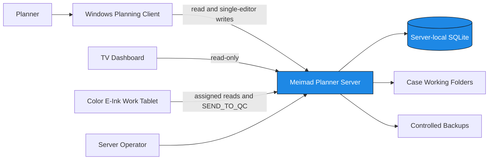
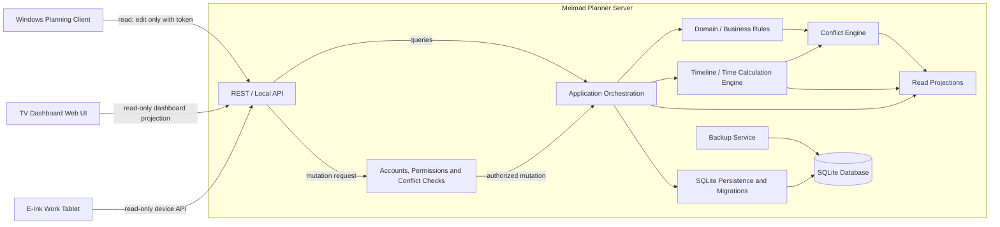
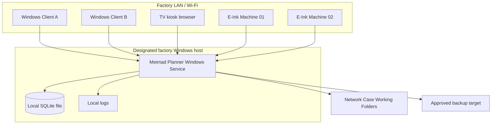
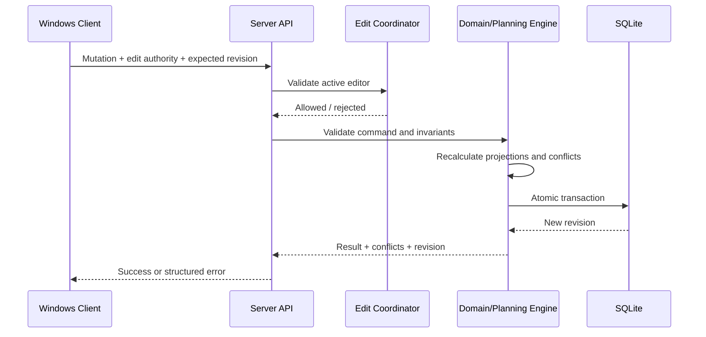
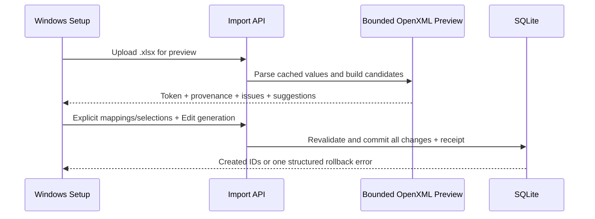
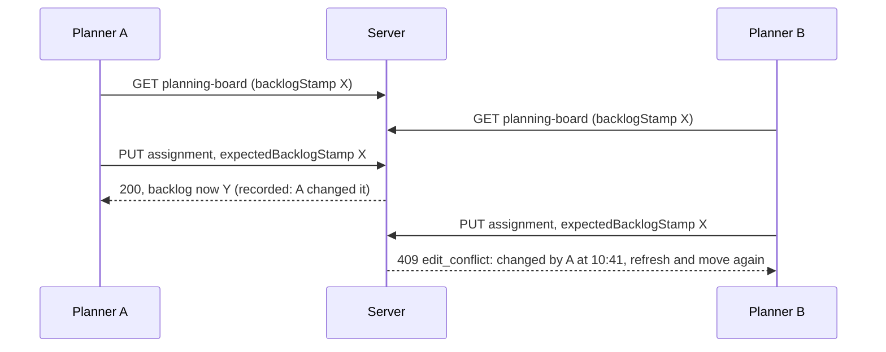
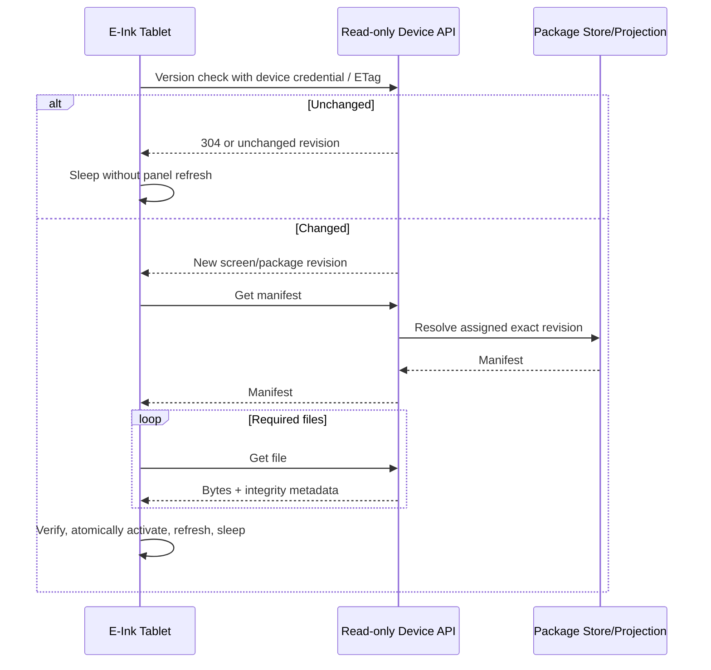

# Architecture

## Calculation-local performance indexes (2026-10-08)

The auxiliary allocator indexes reservation boundaries and reservations by resource only within one calculation, reusing calendar intersections for identical candidates. Calendar reuse is bounded to 1,024 candidate pairs and 65,536 windows; further pairs use the ordinary intersection calculation. It retains the original global candidate boundaries, duplicate load, capacity and pin semantics, ordering and tie-breakers. Completed assignments and dependency validation use stable-ID lookups. No result or reservation index survives into another request. Timeline's final assignment-identity diagnostic groups public blocks once by ordinal assignment ID while retaining duplicate/missing-block warnings. Neither optimization changes Machine assignments, backlog order or persisted facts.

Timeline metrics additionally separate full projection, mapping, presentation, global identity normalization, readiness annotation, final assembly and deferred diagnostic persistence. Subphase durations overlap their parent totals; they must not all be summed. These metrics explain a measured large-workload bottleneck, not a factory performance acceptance claim.

## Operational evidence follow-up (2026-10-08)

`LocalOperationalEvidence` extends the evidence service with existing engine/repository facts. Run forecasts use `TimelineProjectionService` with Board's 30-day horizon, no diagnostic writes, and the outer evidence consistency scope; only conflicts involving selected Run output operations are included. SQL aggregation reads immutable workflow and cycle-attempt evidence, exact package pointers and scoped device/integration observations. It does not recalculate readiness or mutate any source. Full cycle duration is attributed to its completion interval and uses the same Server-receipt basis as Timeline samples. Scope, truncation, observation/receipt distinction and current-versus-historical validity are explicit. Shop shares the existing bounded AI panel; Machine changes invalidate its previous context.

A forecast may be reused only across the three attempts of one explanation, at its fixed evaluation instant and identical planning-input revision, after validating that revision around the original calculation. Full event-evidence validation still surrounds each bundle attempt. Diagnostic appends therefore retry the small evidence read without forcing repeated unchanged forecasts. Planning changes invalidate this request-local forecast; no cross-request forecast cache or stale-result fallback is introduced.

An optional forecast cancellation budget defaults to three seconds and is clamped to 1–10 seconds even in disabled-model operation. A timeout is retained only within that explanation at an unchanged planning revision, avoiding repeated expensive attempts after diagnostic-only changes. The source bundle retains an explicit unknown forecast fact. Caller cancellation is distinct and propagates. Currency checks cannot label a missing forecast current; they return `CHECK_UNAVAILABLE`.

## Workbench and pilot implementation follow-up

ExecutionContextService resolves read-only recipe/demand details in one SQLite snapshot. Windows still sends exact IDs/stamps to existing package operations; its workbench does not reimplement action eligibility. Package file inspection uses immutable artifact endpoints and verifies length/hash locally before opening read-only text. It cannot transfer files to a CNC or establish workflow state.

The optional AI lifecycle persists completion metadata before publishing a completed in-memory answer. Owner-bound source inspection rechecks approved document bytes and compares relevant scoped facts rather than using the global projection revision as a freshness verdict. A versioned persistent suspension control cancels optional work without touching Planner state. Explicit user feedback has its own schema v107 table; it is not used as production input.

Deployment tools are opt-in: read-only Windows host inventory, an executable-hash-checked local runtime launcher, and a synthetic 54-case/three-repeat adapter evaluation using existing local model artifacts. They install nothing and contact no factory database. No hardware/model evaluation has run. [Deployment](local-ai-deployment.md), [manifest](local-ai-model-manifest.example.json), and [evaluation record](local-ai-evaluation-report.md) retain the uncommissioned status.

## Approved corpus and handoff boundaries (2026-10-08)

LocalCorpusService performs bounded file reads outside SQLite transactions, then atomically replaces its rebuildable index after checking the approved-folder version. Search reopens sources and verifies hashes/approval. Originals are never changed. Removing/rebuilding the index leaves planning and execution untouched.

PackageHandoffService uses existing exact-context and current-package predicates in its SQLite write transaction. It shares setup qualification matching with Timeline and appends an immutable versioned receipt plus structured tracking event. Readiness and CNC workflow do not consume handoff as authority. Windows supplies IDs/stamps; the Server revalidates every recording.

## Optional evidence and model gateway (2026-10-08, initial implementation)

LocalEvidenceService wraps existing Run/readiness and scoped event reads in ProjectionConsistency. LocalAiRequestService serializes work through a bounded channel with per-account admission and cancellation; no model call holds a SQLite transaction. LocalAiOptions is disabled by default; the Server-held `local_ai_settings` row (`LocalAiRequestService.UpdateSettingsAsync`, applied to the live options at save and at start) enables it and pins the model/runtime, while the loopback `BaseUrl` and budgets stay in configuration. The initial Ollama adapter accepts loopback IP HTTP roots only, disables redirects/proxies, verifies `/api/version` and local `/api/tags` digest before `/api/chat`, and never pulls models or invokes tools. Input uses conservative UTF-8 byte budgeting; responses have a byte cap. Strict claim-order validation preserves every Server claim and citation; rejected/unavailable runtime output falls back to deterministic claims. Factory-LAN GPU expansion and actual commissioned version/digest remain future configuration work.

API reference used for the adapter: [Ollama chat](https://docs.ollama.com/api/chat), [local model metadata](https://docs.ollama.com/api/tags). Their availability is not evidence that a runtime or model has been installed or commissioned here.

## Operational diagnostics and reviewed imports (2026-10-08)

OperationalHealthService samples SQLite health facts in one read transaction, releases it, then reads local recovery status and in-memory artifact inspection. Pages carry their sample time/revision; there is no cross-page or database/filesystem atomicity claim. OperationalEvidenceReader uses bounded time/ID keyset pagination and projects only allowed metadata. These services neither contact CNC/ERP/AI nor create planning authority. Import last-success persistence is migration v103. Interrupted backup and failed scan attempts retain their prior successful evidence separately.

Owner-approved mandatory ERP review is enforced in SqliteKitaronSyncRepository before commit, using the same before/after diff as preview and the last durable mapping receipt. ReviewedPreview can be supplied only by the Server preview service after actor, expiry, source, mapping, connection and local-context checks. It is never a client-controlled bypass field. Domain changes and receipt commit together; blocked unreviewed attempts roll back all domain rows.

## D05 measured read-path changes

The disposable profiler accepts `-Workload independent|shop` and independent `-HistoryEvents 0..100000` dimensions. The default independent workload is retained for historical comparisons. Shop data adds four-operation batches, every dependency mode, qualified setup workers, shared employee/workstation requirements, external lead time and a synthetic calendar closure. History is retained QC workflow evidence on one completed Run with a separate recipe and inactive Machine; it is not CNC cycle-history or write-contention coverage. Timeline JSON includes the warmup projection's operation/dependency/resource counts and conflict codes, so quick results from blocked or empty projections are visible. These options affect only test-owned databases and profiling output, not runtime configuration or endpoints.

Run-card projection preloads exact output recipe/Machine fields in 100-output chunks (200 bound parameters), then enriches those contexts using their exact output IDs. `OutputFacts` keys the complete internal package context and validates its owning connection/read transaction at reuse. Only outputs whose operation basis has one matching assignment are covered; split/ambiguous assignments, absent keys and preload failures retain the scalar path. Scalar and batch reads share recipe SQL and materialization. Program allocation validation and tooling evaluation still run in the existing Run readiness path; mutation readers never receive these projection preloads.

Transactional multi-operation readiness and eligible Run-card exact outputs batch verification/session/current-loader evidence and eligible offset-package/tool-count reads in chunks of 100 contexts (800 bound parameters), using the scalar reader's shared matching predicates and evidence-stamp materializer. Exact Run/Machine/NC/current-loader binding remains mandatory. Multiple eligible session observations fall back to the scalar reader, preserving the requested output ID. Standalone, untransactional and uncovered exact-output enrichment retain scalar reads; nothing is retained beyond the caller's snapshot. `planner.readiness.enrichment` measures each scalar or batch helper invocation, not SQL statement counts.

Run-card and preparation exact-output enrichment preloads postprocessor support, current NC release lists and latest Tool Room preparation facts for the selected Machines, process revisions and operations. Recipe lookup follows the selected/pinned program process, including coupled outputs whose source operation differs from the recipe operation. `ReferenceFacts` records covered keys and its owning connection/transaction: covered-but-absent facts remain absent, uncovered keys use the original reader, and another/completed snapshot is rejected. Existing 500-ID SQL chunks bound parameters. No reference object survives the read transaction; standalone mutation readers retain their current-fact path. The `planner.readiness.references` histogram measures successful helper invocations (including their chunked queries), not individual SQL statements.

Readiness enrichment shares the current verification-enabled package membership set within each caller-owned SQLite snapshot. Board operation reads reuse their existing set; Run cards and preparation queues load it once and pass it through exact-context enrichment. Transactional batch readiness reads load the set once when needed. Single untransactional reads retain their individual lookups, and no set is retained between transactions/requests. Verification-session, exact-release/current-loader and offset-mode matching rules are preserved by the scalar and batched queries. Ambiguous-operation detection uses one grouping pass instead of scanning all rows for every operation. `planner.board.source` measures Board source projection; `planner.readiness.workflow_packages` measures successful membership-set queries. The profiler reports aggregate milliseconds alongside sample counts/percentiles.

The Run list loads Runs, programs, outputs and active assignments in four ordered queries under one read transaction. Board/Timeline Run cards share that graph and batched readiness bases within a single SQLite snapshot; exact program-revision and allocation validation remain in the existing readiness evaluator. Ambiguous/split assignments retain exact-context fallback, and preload failures fall back to per-Run reads with the existing not-ready error isolation. Mutation/start/physical-production checks continue to read their own current facts; projection preloads never cross transactions or requests. D02's outer revision check still covers the combined Board/Timeline response. The `planner.runs.graph` and `planner.runs.readiness` histograms measure graph hydration and the subsequent readiness/card-assembly phase respectively.

Preparation reads preload operation readiness in batches, falling back to the existing exact-assignment reader for ambiguous/split contexts. Current-package validity is evaluated using two batched queries plus the already observed readiness/context facts; it no longer hydrates every current package, artifacts and a second readiness graph merely to produce a boolean. Parity tests compare the optimized result with the full current-package reader for live and stale contexts. No new index is introduced without a query-plan measurement.

`ProjectionResponseCache` coalesces Board, preparation-stage and Timeline endpoint work by database revision and complete request identity. Completed entries exist only for explicit-asOf Timelines: 10-second expiry, 32 entries / 32 MiB total, at most 8 MiB per entry. Serialization uses the configured HTTP JSON options and immutable serialized response bytes. Live requests share only active work; completed live results are not cached. At most four distinct calculations run; independent callers have cancellation leases, and the last departing caller cancels shared work. Failed/cancelled computations are not cached. D02 still validates each produced Board/Timeline projection; cache admission additionally checks revision after serialization. Authentication/session revision changes may reduce cache/coalescing effectiveness in a real signed-in deployment; the synthetic TestServer uses test authentication.

Long-range reports have a separate one-request admission gate and explicit bounded horizons. Timeline and auxiliary-resource engine loops observe execution-context-scoped cancellation, restored after synchronous/nested calculations. The package-build limit extends D04's per-root activity registry; concurrent builders remain supported within the configured limit. Source and generated byte budgets are separate per build. Source bytes needed for transformation remain buffered within those bounds; output/download re-verification hashes streams.

The `Meimad.Planner.Performance` Meter exposes HTTP request counts/durations/known response sizes, SQLite open duration/open-busy counts, preparation read-transaction duration, Timeline source/engine/baseline/auxiliary phase durations, serialization and coalescing/cache counts. Route tags use templates, not IDs/query strings; no credentials or NC bytes are logged. Existing Timeline source-query logs and Windows view-model/render traces remain available. These metrics do not yet measure every SQLite write-transaction wait or external CNC ingestion lag.

## D04 artifact reconciliation boundary

`PackagePublicationJournal` durably writes a same-directory `.publication.json.pending`, flushes it, then renames it to `.publication.json`. A STAGING journal precedes generated files; a READY journal includes exact logical paths, sizes and SHA-256 values for all artifacts including the immutable manifest. The directory is moved before C04's SQLite publication. A crash before/after each boundary is recoverable as inspection evidence: incomplete/ambiguous, complete staged, published-unreferenced, or database-referenced. SQLite references/current pointers remain authority; a READY journal alone never authorizes activation. Journal files are diagnostic publication metadata, not CNC artifacts or a second package catalog.

`SqliteArtifactInventory` reads existing typed package/release/E-Ink references in a short SQLite snapshot. Reconciliation closes that transaction before filesystem traversal/hashing. A process-wide per-root activity lease permits concurrent builders but excludes scans/collection while builders are active and excludes new builders during a scan. The existing recovery-artifact lease excludes deletion during online backup snapshot/copy. Backups embed referenced bytes, so completed complete recovery sets do not depend on later retention of live orphan files. No recovery archive is collected.

Startup runs one background scan; maintenance can repeat it. Results are cached in memory with timestamps, bounded to 500 displayed items, with problems prioritized and full totals/truncation. NC marker traversal refuses links and is bounded by depth 64 / 100,000 directories. Hashing is streamed and cancellable. Scans may be stale after a later pointer/file change; they are health evidence rather than an authoritative readiness cache. Realistic scan duration, writer/backup contention and journal power-loss durability remain installed/D05 acceptance work.

Manual configured collection uses the same leases, rereads all references, protects directories by both package ID and canonical referenced path, verifies journal contents and requires all entries to be known and older than the grace cutoff. It never touches referenced history, unknown contents, NC/E-Ink releases, incomplete publications, originals or backups. Interrupted collection remains unreferenced; leftovers are reported, not activated or force-deleted. The old immediate orphan NC startup remover is superseded. No schema/index is added: existing typed reference indexes are reused; query-plan changes require D05 measurements.

## D03 import snapshot and review boundary

The SQL source reader uses one read-only SQL Server transaction across its source queries, without NOLOCK: a SNAPSHOT transaction when `sys.databases.snapshot_isolation_state` reports it on, otherwise READ COMMITTED (owner decision 2026-10-09: the factory database has no snapshot isolation, Planner does not change ERP settings, and 0.1.190's hard requirement had refused every import since its installation). Under a SNAPSHOT read the reader inspects the configured view and its local module dependencies; a dirty-read hint, an external reference, an invisible definition or excessive depth becomes a caveat recorded with the read mode in the import evidence, never a refusal. ERP administrators own configuration and VIEW DEFINITION access. Factory SQL acceptance remains pending.

Preparation records a content fingerprint, source endpoint, read-window evidence, connection/mapping versions and a local context hash. This is not an ERP LSN or a distributed transaction: apply rereads the source, but ERP may change after that snapshot finishes. No ERP call runs while SQLite's import write transaction is held. Preview does hold the SQLite writer while executing the same import and collecting its bounded diff, then rolls back. Apply checks the original context and commits domain mutations plus its receipt in one transaction.

The import context hashes local application tables conservatively, excluding authentication/session tables, CNC polling and diagnostic tables (telemetry, DPRNT lines, connection events and state, Haas snapshots and bench sessions, operational anomalies), projection counters, sync status, the connection/mapping configuration rows (their versions are compared separately), push runs, local AI requests and structured diagnostic/receipt events. It includes domain state; it is distinct from D02 projection freshness. Only a reviewed preview reads the hash (`PrepareAsync(withLocalRevision: true)`); the automatic import applies against the live database and records a receipt without a local revision, because the hash walks the planning tables inside the write transaction and background work would make it stale within seconds. Performance under production-sized histories belongs to D05. One actor-bound preview lives in memory for 15 minutes, is replaced by the next successful preview, and is lost on restart. Its committed receipt survives restart, but the API requires a live preview token for retries. The D03 guard (unreviewed destructive changes or changed mapping interpretation refused atomically; reviewed apply supplies the preview evidence) sits behind `KitaronImportPolicy.ReviewedApplyRequired`, off until the owner decides.

## D02 version-stable projection reads

`ProjectionConsistency` validates database revision around a whole board, Timeline or readiness computation. Nested reads share an evaluation instant and rely on the outer validation; they do not multiply the retry limit. Each attempt uses existing repository read transactions, released before the Timeline engine, and retries on any source revision change. At most three attempts are allowed before an explicit retryable 503. Board Run cards are reused by its Timeline calculation. Diagnostic effects are deferred until validation, so abandoned attempts do not emit derived evidence.

Schema v102 introduced conservative transactional table triggers. Schema v108 separates planning from full evidence by subtracting an atomically maintained non-planning counter for audited diagnostic/AI tables; schema v109 (audit finding 2026-10-09) adds the CNC polling, connection-check and device-contact tables to that counter, because on the factory database they had moved the planning revision about once every 1.7 s (70,905 planning bumps against 991 non-planning) and a Board/Timeline read overlapping three polls answered 503 `projection_changed`. Structured manual Machine move/report events remain planning inputs; AI evidence counts all structured events, including derived diagnostics. Newly added tables invalidate planning by default. The epoch and scope identify each counter; a service-runtime ID distinguishes process/configuration changes. This is consistency detection, not a lock, planning authority, or a distributed snapshot. External files/ERP are outside this local revision boundary. Independently issued API responses may legitimately have different revisions; callers must not combine them as one snapshot. D05's bounded response cache uses the planning scope and complete request identity.


## D01 complete recovery boundary

The Server now creates encrypted, manifest-backed recovery sets independently of database-only backups. A process-wide artifact cleanup lease is acquired before an online SQLite snapshot; references are read from that snapshot, never from later live state. Existing immutable-artifact cleanup paths participate in the lease; publishing new immutable artifacts can continue. Copy/checksum failure prevents publication. One authoritative Server process per database remains required; the lease is not a distributed lock and cannot prevent external filesystem deletion.

Every candidate is decrypted and restored into private staging, checked against its inventory/database references, and tested for Data Protection key usability before its completion marker is published. Replacement keys use Windows machine DPAPI with restricted filesystem access. Offline restore bypasses normal startup/workers, requires a new directory and writes an activation-guarded configuration. External Windows Task Scheduler is the only approved scheduler; no retention changes or live service deployment are made. Four-hour RPO/RTO remain measured acceptance targets. See [the recovery runbook](recovery-runbook.md).


## C08 durable ERP delivery boundary

SQLite owns immutable push intent and lifecycle, while SQL Server owns ERP commit. The Server persists Prepared before it can claim Writing or call the target. A successful return from SQL commit precedes the local success receipt; failures between these authorities are represented explicitly as OutcomeUnknown. The SQL target reports proven pre-commit rollback separately; commit-attempt errors are conservatively uncertain. If SQLite is unavailable after writing, the durable Writing claim blocks replacement attempts and is recovered on the next Server startup. Recovery runs before the push hosted service starts; it never dispatches retained intents.

The repository serializes new deliveries and claims with SQLite transactions/CAS; the in-process semaphore is only an additional guard. The deployment remains one authoritative Server process per database; startup recovery is not a distributed lease for multiple live Server processes. Reconciliation uses reads against the stored target and appends versioned evidence; acknowledgment records the reviewing user and enables a new freshly planned run without replaying the old one or asserting attribution. No remote worker, general outbox transport or ERP API is added. Existing SQL Server acceptance limitations remain.


## C07 ERP comparison boundary

The existing four-field Kitaron push carries typed expected ERP values from read to write. Read-committed preview queries omit NOLOCK. The writer acquires update/range locks on each target Work Order and its operation rows in a Serializable transaction, validates identity, unique matching, current open status and exact mapped values, then updates all changed fields of the row. Locks remain until the whole push commits; a failed comparison rolls back all independent items too. Direct update counts use OUTPUT INTO and an output parameter, independent of AFTER-trigger counts. Enabled INSTEAD OF triggers are unsupported and refused. No SQL Server database option is enabled by this change.

The optional preview stamp binds a displayed preview to the next manual request; Windows carries it without calculating ERP rules. An unstamped run still constructs its own fresh plan and validates its expected values at commit. The existing owner-approved SQL connector/login is unchanged. Import-only installations should retain a read-only SQL role: ApplicationIntent.ReadOnly alone is not authorization. No vendor-approved integration API has been established by this change; the existing direct SQL path and factory triggers require isolated acceptance. C08 implements durable intent and uncertain-outcome review as described above.


## C05 shared readiness core

`ProductionActionPolicy` classifies the common operation preparation facts by requested action. `SqliteProductionRunReadinessRepository` resolves each program/output against its assigned Machine and recipe in a single read transaction, evaluates the same facts, then aggregates allocation and combined-tool constraints. The Run mutation repository reuses that reader in its write transaction, comparing the observed evidence stamp before publishing Run Start. Windows renders server decisions rather than reconstructing gates. Exact CNC verification remains an independent boundary; starting a Run does not prove setup or physical production. Manual setup reports use the setup action and retain their supported reporting modes. Operation Start revalidates the optional observed stamp and all prerequisites within its mutation transaction, including Resume. CNC cycle starts use the same production decision; ends of previously accepted physical cycles remain factual evidence even after readiness changes. QC and controller verification authorities stay separate. D2 policies were explicitly approved on 2026-10-08: unknown capacity blocks managed work requiring tools (zero-tool work remains allowed), and unmanaged legacy NC/tool-release exemptions remain subject to material readiness and valid execution context.


## C04 publication boundary (2026-10-08)

`ProductionPackageService` owns staging and generated-file verification; `ProductionPackageFiles` isolates generated file I/O from read-only source releases. Generation and file hashing remain outside the database write reservation. Before publication the service holds read-only handles to the final files; Windows denies writes/deletion until publication ends. `SqliteProductionPackageRepository.PublishAsync` reconstructs generation inputs on the same connection/transaction used to compare the observed publication stamp and write package, artifacts, context/current pointers, predecessor invalidation, applicable loader and request receipt. A competing publisher replays an identical receipt or receives a conflict; it cannot silently replace an unseen predecessor.

Successful replay comes entirely from the immutable Server receipt and works through a fresh service/repository instance. Windows holds uncertain commands in memory for explicit retry within the same signed-in session. A lost response never justifies deleting committed artifacts: cleanup removes a final directory only after a fresh durable read proves it unreferenced, and retains it if that check fails. Crash-time orphan reconciliation, durable client retry queues, and retention/recovery-set policy are not implemented here. Existing Run/Machine/NC/Offset Loader verification remains separate from package generation.

## C03 package and preparation context (2026-10-08)

`SqliteProductionPackageContext` resolves live assignment -> Run -> program -> output identity and checks recipe/quantity membership. Package construction and preparation reads use exact Machine/process/tool facts; queue metadata, readiness and current-package validation share a SQLite read transaction. The Windows client carries IDs and observed stamps and keys selection by assignment/program/output, without duplicating authority. Schema v99 stores immutable context alongside packages and a current pointer per tuple. Historical inspection is separate from live resolution. Package activation rechecks context in its write transaction; C04 adds publication compare-and-swap and durable request receipts as described above. C05 unifies the action-specific readiness contracts as described above.

C01 timing repair (2026-10-08): schema v98 transactionally normalizes manual timing evidence through an event-insert trigger, with complete paged migration backfill and synchronous sample/session/aggregate diagnostic views. `SqliteOperationTimeMeasurements` reads that durable source; a normalized append checkpoint invalidates its cache even for late-arriving reports. `TimelineProjectionService` no longer performs a separate globally capped timing reconstruction and uses the repository's existing measured-median inputs. See the v98 data-model section for source identity, session boundaries, warnings and rebuild semantics. No background projector, client database access, or new reporting endpoint is introduced.

Windows appearance (2026-10-08): `Themes/ApplicationResources.xaml` composes shared controls and operational resources; `Themes/Workbench.xaml` defines the visual tokens/templates. `WorkbenchTheme` replaces application brush resources on the UI dispatcher, adapts literal neutral brushes in programmatic dialogs once, and stores only `graphite`/`light` in `%LocalAppData%\Meimad Planner\workbench-theme.txt`. Failed preference writes leave the session usable. No Server API or database state is involved. Existing XAML bindings and view models remain authoritative for displayed data and command availability. The NC WebView receives only a fixed theme name through a local script; local CSS overrides avoid modifying the vendored viewer.

Audit repair slice (2026-10-08): schema v97 introduces a Server-owned auxiliary-pin version ledger that survives clear/recreate. Pin eligibility and expected-version checks share the SQLite write transaction; Windows carries the observed stamp and retains selection on conflict. Cycle deduplication validates the persisted immutable target/payload before reading the same Run's current projection. Neither path changes Machine scheduling authority, CNC identity or TV/tablet scope. The approved action-specific readiness/handoff matrix and remaining source-audit findings are tracked in [the implementation plan](implementation-plan.md#audit-handoff-2026-10-08); unified readiness, complete backup sets and local AI remain future implementation work.

The Kitaron connector treats `OrderClosed` as a coded value: `1` is open and `2` is closed. Other recognized Boolean row/header closure values close on nonzero, and `StopProduction` retains cancellation precedence.

Controller workflow boundary: **Persistent CNC workflow mode variable: REMOVED.**
**Protected temporary setup verification variables: SUPPORTED** only within the
Machine-configured and physically commissioned handshake; Server events remain
workflow authority.

- **Status:** Target architecture; Server foundation through schema v65, Production Runs, operational workflow-event and human debug-timeline projection, post-QC DPRINT cycle completion/interruption, raw attempt timing, automatic session closure, staged legacy import, Timeline, TV Dashboard, E-Ink API/simulator, Single Edit Mode, verified backup, derived role queues, immutable Production Packages, generic resource masters/provisional allocator, Windows operational workspaces including QC Queue, and Case Operation graph validation implemented
- **Scope:** Factory-local MVP

## 1. Architectural drivers

The NC postprocessor boundary is deliberately server-blind. Canonical protocol
v2 output contains deterministic machining code plus exact
`[[MEIMAD:<KEY>]]` placeholders; even Part and Operation names remain
placeholders. `ProductionPackageService` loads the concrete Planner assignment,
immutable NC and Tool Table releases, Machine capability/verification policy,
and current Production Run, then transforms a copy in staging. It resolves
master-data values, conditionally injects the existing verification hook,
generates the uniquely bound Offset Loader when applicable, verifies hashes,
writes manifest schema v3 with the exact program/output context, and only then atomically changes the current-package
pointer. The immutable source is never rewritten. Connectivity affects delivery
options only and never downgrades verification policy.

- Keep one authoritative data owner.
- Eliminate direct multi-client access to a shared database file.
- Preserve fully manual planning while calculating consequences and explaining conflicts centrally.
- Support one full planning-editing surface, read-only displays, and one narrowly scoped tablet operational command.
- Keep the factory deployment independent of public Internet access.
- Support low-power devices that wake briefly, transfer only changed data, and retain a last-known-good display.
- Make backup and restore an owned server responsibility.

## 2. Current repository state

The repository contains an implemented .NET 10 Server host and server-owned SQLite schema version 67. Schema v34 adds explicit Machine execution/capacity/timing and Postprocessor compatibility; v35 adds process/tool-table/G-code releases and production pins; v36 adds immutable normalized required-tool rows/count; v37 adds assignment release selection and contextual offset confirmation; v38 adds NC analysis/estimates; and v39 adds locally verified material receipts and explicit Batch reservations feeding centralized readiness. The Server owns a localhost-only Kitaron connector whose SQL client always uses `ApplicationIntent=ReadOnly`; connection testing runs `SELECT TOP (0)`, while synchronization selects parts from the planning view and `TTreeNodes` BOM, then reads every canonical `TSubOrder` row for those parts regardless of planning-view Order-number coverage. Every distinct delivery row is a separate Planner Order named `<OrderNumber>/<RecordID>` with that row's quantity and supply date. Kitaron owns the Order set for synchronized Cases: absent Orders and stale links are removed atomically. The current-demand read model is fail-closed: a Kitaron-managed Case exposes only nonhistorical Orders having a committed Order source link, so an unlinked orphan left by an earlier partial scope cannot reappear as local demand. Dependent never-started direct/derived Production Batches are intentionally removed first through the shared complete Batch deletion graph, including their planning and execution projections. A superseded Order tied to a structure-locked Run is instead marked history-only and excluded from current demand while its immutable production graph remains stored. An exact legacy plain-row match is adopted during migration so it is not double-counted. Credentials remain encrypted and absent from API responses. A Ready mapping drives periodic/manual synchronization that atomically applies the unified Case pool, parent Orders, child routes, and every valid direct Case Component edge returned by Kitaron, including BOM-only roots absent from the planning view and a fresh Planner database. Duplicate source edges reuse one parent/child relationship. Stale connector links whose targets were deleted are repaired during the transaction. Parent Operations are skipped; a legacy parent route skips only its conflicting component edges with warnings instead of aborting unrelated imports. `StopProduction = 1` maps to cancelled. The connector itself creates no material receipt/reservation or Kitaron mutation.

Production Batch cancellation is a server-owned immediate transaction, not a client-side status edit. It terminates the selected Batch execution graph, zeroes mutable count projections, closes active execution intervals, releases reservations/assignments, compacts affected backlogs, recomputes linked demand, and appends a structured audit event. Append-only CNC cycle/workflow evidence is deliberately retained. The transaction rejects a Production Run shared with another Batch so the multi-output atomicity boundary cannot be broken by a single-Batch command.

The API-only Windows client has a compact connection/signed-in-user header, Setup page, User Terminals page, and QC Queue. The Planning Board and Timeline remain Server-authoritative, manual planning surfaces; TV is read-only. E-Ink package/planning access remains read-only, with the separately scoped `SEND_TO_QC` command outside Edit Mode. Schema v54 implements idempotent sends; schema v55 scopes retry identity to one inspection attempt so `QC_FAIL` can return to setup and permit a fresh send. The read-only QC Queue is available without Edit Mode, while PASS/FAIL require the active editor and append user-attributed workflow events. The ESP32 prototype compiles a bounded status client and guarded send action, but physical interaction and shop-floor validation remain incomplete.

The Case workspace contains a client-local STEP presentation boundary. `OCCSharp` dynamically invokes OpenCascade to read the selected B-rep and tessellate its faces under explicit file/vertex/triangle limits; WPF `Viewport3D` owns depth-buffered display and PNG capture. The same unscaled mesh, center-of-gravity target, orthographic camera width, and uniform screen projection serve three presentation-only modes: Shaded, Visible edges (boundary/crease/silhouette overlay), and Wireframe (unique tessellation edges with faces hidden). Initial load fits the camera exactly once; orbit and resize rerender without recalculating the fit, wheel zoom changes only the stored camera width, and explicit Fit recalculates it. The 2D edge/bounding overlays project the original mesh coordinates through that same camera basis and center, preventing the former rotated-bounds centering offset. Shaded is the load default, with edges and bounding box off until requested. No STEP bytes, mesh, display mode, camera state, or measurement is sent to the Server or stored in SQLite. Fit uses only tessellated body vertices, excluding STEP coordinate-system entities. Closed consistently oriented meshes use a signed-volume center of gravity as their orbit target; open/non-solid geometry falls back to its geometry-vertex centroid. If OpenCascade cannot produce faces, the UI labels and displays the bounded legacy edge/point fallback rather than fabricating a solid.

The STEP renderer layers a depth-sorted WPF `DrawingVisual` triangle surface with the depth-buffered `Viewport3D`. Both consume the same tessellation, center, camera orientation, and fitted width; the software surface guarantees a visible shaded model when the workstation's WPF/GPU 3D path yields a blank frame.

Canonical Kitaron Order selection is part-based: the planning view and imported `TTreeNodes` BOM identify the relevant `DetailID` values, and the connector retrieves every `TSubOrder` row for each of those parts without requiring the individual Order number to be present in the view. This is the effective selection rule for complete Kitaron-managed Case demand, including BOM-only child Cases.

## 3. System context



The Server is the authority. Case Working Folders remain external file storage; the database stores their paths and generated preview/cache references, not copies of original engineering files. When a configured drive-to-UNC mapping names a multihomed file server, preview resolution tries each resolved IPv4 address after the canonical UNC path so an unreachable secondary adapter does not remove Case pictures from every Server-backed UI.

### 3.1 MVP boundary

The complete MVP runs on the factory network:

- One Meimad Planner Server process on a designated Windows host.
- One Server-owned local SQLite database.
- Windows Planning Clients using the local REST API for all reads and edits.
- Read-only TV Dashboard browsers using dashboard projections.
- E-Ink Work Tablets using device-scoped display/package reads and the single `SEND_TO_QC` operational command.

The architecture has no Customer Portal, cloud service, public Internet endpoint, router forwarding, or native mobile application. Those are outside the MVP boundary and must not be provisioned as dormant components.

## 4. Component responsibilities

### 4.1 Required component map



Every box inside the Server is a logical component. They may initially ship in one Server process, but their boundaries must remain explicit in code and tests. SQLite and the Backup Service are inside the Server trust boundary; no client can reach the database file.

### 4.2 Meimad Planner Server

The implemented `server/` component is the sole authoritative runtime. It hosts the API and coordinates domain validation, manual-plan mutations, timeline calculation, conflict generation, read projections, Single Edit Mode, persistence, migrations, backup, and the LAN-served display simulators.

It may run as a console/executable during development. The production target is one Windows Service on a designated factory PC or local Server.

### 4.3 REST / local API

The API is the only client entry point. It provides versioned REST endpoints over the factory LAN or host loopback and owns:

- Request parsing, contract validation, authentication, and authorization once the identity model is approved.
- Edit-token and optimistic-concurrency checks for mutations.
- Command dispatch to application orchestration.
- Purpose-built read projections for Windows, TV, and E-Ink clients.
- Stable error codes, correlation IDs, health/readiness, and safe failure responses.

The API must not contain authoritative scheduling or domain rules. It delegates those rules to the Server layers below it. No public listener or Internet-facing gateway is part of the MVP.

The legacy import boundary remains staged and read-only until Commit. The temporary Windows tool now submits one authoritative fixed Case/Order mapping, displays the resulting rows, and commits only valid Case and Order selections. Part Number is the Case key and Case + Order Number is the Order key; invalid rows are explained skips and existing manual data is not silently overwritten. The former Batch/Machine wizard is bypassed by the current client, which sends no planning rows, Machine mappings, allocations, assignments, backlog, Timeline, or mode changes. The bounded preview endpoint and durable receipts remain as compatibility infrastructure until Kitaron replaces Excel import. Schema v27 permits a later fixed Case/Order-only pass for the same workbook to receive a separate receipt, so an earlier partial approval does not strand remaining rows. Exact approvals replay, ordinary Case/Order uniqueness remains authoritative, and any changed approval containing planning content remains rejected. The repository checks Edit authority and commits each selected canonical Case/Order pass in one immediate transaction. The source `.xlsx` remains external and read-only.

### 4.4 Domain / business rules layer

This layer owns authoritative state transitions and invariants for Cases, Orders, Production Batches, allocations, Case and Batch Operations, Machines, assignments, calendars, and downtime.

Material reconciliation follows the same Server-authority boundary. The Windows editor records Case-scoped physically verified receipts and explicitly replaces a Batch's receipt reservations. SQLite v39 stores those facts and the readiness context reader derives one Batch-level material result for all of its Operations. Kitaron sync never writes these local verification/reservation tables, and no client opens or calculates against SQLite.

Kitaron source ownership is enforced in the Server persistence/application mutation path, not only in WPF. A durable Case source link makes imported Case master fields and its complete direct Order collection Kitaron-owned; linked Order rows carry canonical reference, quantity, supply date, source status, and the unit Price in NIS from `TSubOrder.CostShkalim` (the NIS line price Kitaron invoices; a zero is stored as no price). The Case link blocks planning API and legacy-import writes even for an old unlinked child row, while the Order link identifies current demand and controls its eligibility for a new Batch allocation. Normal clients can read stable historical records but cannot update/delete the Case or create/update/delete its Orders. The synchronizer retains its separate internal atomic write path so it can replace the authoritative snapshot. Unlinked manually created Cases remain locally editable.

The connector mapping surface exposes canonical Order status and Price as connector-managed fields. They cannot be disabled or remapped: status combines recognized row-level `TSubOrder` and header-level `TOrder` closure/completion flags, with `TSubOrder.StopProduction` taking cancellation precedence, and Price is read only from `CostShkalim` (`PriceInCurr`, the earlier choice, is set on a handful of rows of the commissioned database and read every other order as 0; a zero source value is stored as no price). Configurable planning-view mappings remain separate from these fixed canonical rules.

It validates that Orders remain demand-only, only Batch Operations are assigned to Machines, allocations follow the approved balance equation, dependencies retain their defined meanings, Case timing summaries are derived from operation timing, Batch and linked Order statuses follow production facts, normal Machine/Machine-Type compatibility remains safe, cross-type exceptions require explicit confirmation and reason, Machine Type renames/deletes cannot strand Operation requirements, and original engineering files are not modified. It has no dependency on REST, UI, SQLite, filesystem implementation, or device firmware.

### 4.5 Timeline / time calculation engine

The read-only calculation uses one fixed dependency/backlog graph and one Machine-lane reservation set. Not-started Forward/Manual assignments use earliest-feasible split-window placement at or after the Server snapshot cursor; Backward assignments use latest-feasible placement before a transient delivery cutoff while that intended start remains future. Waiting intervals identify Machine/setup/day-shift calendars, skilled setup/QA/regular resources, maintenance, breakdown, pause, and sequential predecessors. Assigned rows excluded from pure placement by missing input, pause, dependency failure, or horizon infeasibility remain operation-linked `blocked` waiting projections beginning at or after the later of the cursor and preceding calculated backlog work; every later stored row is blocked as well so it cannot visually leapfrog an earlier invalid or paused row.

The implemented pure Timeline Engine calculates projected setup, QA, repeated load/unload, production, dependency-waiting, idle, downtime, and locked-group reservation intervals from immutable inputs. Its inputs are explicit Machine backlog order, per-event load and cycle/cadence inputs, explicit half-open UTC Machine/setup availability windows, planned downtime, a calculation horizon, and operation dependencies. Manual work expands to an initial load followed by one cycle per part. Automatic work with N expands to an initial/repeated load followed by up-to-N-cycle production groups; automatic work without N has no load events and one production run. Before materializing phases, the engine returns blocking structured conflict `load_unload_occurrence_limit_exceeded` when any operation would require more than 10,000 non-zero-duration load/unload occurrences. Its message directs the planner to increase an automatic every-N cadence or split the Batch; a manual operation can instead be split or switched to an approved automatic cadence. This fixed reversible guard is calculation safety, not a quantity/allocation mutation, pending broader configurable-cap policy. Sequential edges delay only the calculated child; they never mutate manual backlog order. It has no SQLite, REST, clock, or UI dependency.

For each Machine, backlog adjacency is a hard precedence constraint. Sequential dependencies add precedence; Parallel-capable and Independent dependencies add none. Locked-simultaneous members share the group start (their first activity) and projected finish, are each set up when a qualified setup worker is free, and run as a flow line in operation-number order: part k starts on a member once the previous member has finished part k (a load of several parts waits for all of them) and this member has finished its previous part; each member's Machine is reserved from the group start until its first work and from its last part until the group finish. Setup work uses the intersection of Machine and setup availability; production uses Machine availability; downtime is subtracted. Work may split across availability windows. Each worker-required load event is independently constrained by and reserves a regular-worker calendar. The mode on each assignment is mapped into the same calculation input: a not-started `forward` or `manual` node earliest-fits at or after the Server cursor, `backward` reverse-traverses and latest-fits the same phase segments before the earliest linked Order Work Finish Date while future, returning them chronologically, and `manual` preserves its planner-authored Machine/backlog placement while calculating that visible consequence. A missed Backward start falls forward transiently without changing its persisted mode/backlog, then applies normal backlog/dependency propagation. Mixed modes remain in one graph. All produce consequences only and never change assignment identity/Machine, backlog order, durations, calendars, downtime, dependencies, or stored dates.

The implemented application projection reads current persisted assignment IDs, modes, backlog positions and recorded cross-Machine transfer/pause timestamps, active Machines, Working Calendars, individual active employees with Machine-ID qualifications and exceptions, the dedicated Setup Calendar, planned/open/restored Machine downtime, immutable Batch timing/dependency snapshots, quantities, and allocated-Order priority facts in one SQLite read transaction, then calls the pure engine through `GET /api/v1/timeline`. It derives operation duration from setup, QA, existing per-event load/unload inputs, and `cycle time x Batch planned quantity`; no prefilled planned-start/planned-end fields participate. Manual loading expands to an initial load then one cycle per part. Automatic loading with N expands to an initial/repeated load before each production group of up to N cycles, while automatic loading without N has no load events and one production run. The total duration is unchanged; only the read-only phase placement is segmented. The normal calculation cursor is the Server snapshot time clamped to the requested half-open horizon; not-started forward/manual work and identified blocked fallbacks cannot begin before that cursor, and an elapsed horizon returns end-boundary blocked markers rather than historical forecasts. The earliest linked Order Work Finish Date becomes only a transient backward cutoff. A baseline pass preserves backward latest-fit placement while it remains future; when its start has passed without a recorded Start, a deterministic transient reclassification recalculates that assignment and any newly infeasible downstream backward nodes forward from the cursor. All-backward locked groups reclassify together, while genuinely mixed persisted group modes remain invalid. The projection reserves `backward_start_missed` for operations whose own calculated baseline start actually passed; downstream/unavailable transient reclassifications use `backward_fallback_required`, with separate deadline-risk or no-future-fit conflicts as applicable. Projection normalization emits exactly one identified current operation or blocked-waiting block per active assigned Operation ID and logs/folds/removes duplicate producer output; it does not add a hold/backward/manual layer. Ordinary waiting, downtime, and moved-history capacity intervals are anonymous, while their facts remain attached to canonical phases/detail; an infeasible assignment deliberately retains identity as lower-band blocked waiting. Each Machine separately exposes additive `nonWorkingWindows`, computed as the horizon complement of its authoritative expanded Working Calendar and kept outside the operation interval/identity pipeline. A final same-Machine overlap pass keeps actual/hold/history authoritative, demotes a conflicting forecast to blocked waiting, and returns `machine_operation_overlap` or `actual_backlog_overlap` without mutating assignment/backlog data. Its fixed-point propagation prevents a blocked forecast from being leapfrogged by later backlog rows, Sequential descendants, or locked-simultaneous forecast members; recorded actual facts are retained with blocking conflicts. Suspended elapsed actual work ends at the active pause start. If the assignment moves while suspended, anonymous prior-Machine occupancy remains visible and the current hold begins no earlier than the true cross-Machine move event, falling back to replacement-assignment creation after an unassign/reassign; same-Machine reorder and planning-mode edits do not shift it. Structured Server logs record source/assigned/usable/backlog/resource counts at Information level and per-assignment mode/timing inputs and calculated results at Debug level. Active breakdowns are clipped to the read horizon until an explicit Restore closes them; maintenance and breakdown reasons are retained in downtime intervals. Calendars expand deterministically with timezone/DST conversion, breaks, exceptions, and cached holidays. The engine reserves one eligible employee for each setup, QA, or worker-required load/unload event and emits visible waiting when contention or a calendar gap delays that phase. Forward/manual contenders are compared by earliest Work Finish Date and then naturally smaller Order Number. Backward contenders use earlier Work Finish Date, shorter total duration, naturally smaller Order Number, and stable identity. Setup eligibility uses stable Machine-ID qualifications, with legacy textual tokens readable until the employee is resaved. These calculated reservations and priorities are not persisted and never reorder stored Machine backlogs. Persisted named-worker assignment, skill qualification expiry, plan revisions, rounding, and recalculation SLA remain TBD.

Schema v38 adds a parse-once/evaluate-per-Machine NC timing pipeline. Immutable release analysis is separate from append-only Machine calculations. For not-started work, the Timeline source selects a valid effective-release NC cycle before the preserved manual cycle snapshot; running and historical work stay on the snapshot source. Parser warnings or estimate unavailability do not alter readiness or mutate the plan.

The Windows Setup screen owns Machine/Postprocessor/timing configuration, the Case workspace owns immutable release/history plus Batch material reconciliation, and the Planning Board owns assignment plus a Server-backed Production Readiness dialog. Releases, process/tool activation, verified material receipts/reservations, contextual offset confirmations, readiness transitions, explicit compatibility/capacity failures, and estimate recalculations append to the schema-v22 structured event stream in the same transaction as their source change. The client displays component reasons and submits explicit facts but never calculates readiness.

### 4.6 Conflict engine

The pure engine currently returns deterministic blocking input/calculation conflicts for invalid calendars/durations/references, duplicate placement, impossible locked groups, dependency/backlog cycles, failed predecessors, and insufficient horizon availability. The broader Conflict Engine remains responsible for stable production conflict policy such as capability, deadline risk, missing business timing, accepted warnings, and plan-revision-aware explanations.

Conflicts are projections, not silent repair commands. The engine may cause a structurally invalid command to be rejected according to the approved policy, but it must never mutate a valid manual plan to remove a warning.

### 4.7 Accounts, permissions and conflict checks

Owner decision 2026-09-27 (schema v86) replaces Single Edit Mode. `SignInMiddleware` resolves the bearer session of every `/api/` call to a signed-in account (401 otherwise, 403 while a temporary password is unchanged); device, TV, installer and local Kitaron-setup routes keep their own scopes. Each endpoint checks the permission of its area through `PlanningHttpSupport.TryAuthorize*`; the account's user types grant permissions, the Administrator type grants all. Repositories take the actor from the account (`SignedInActor`).

Users work in parallel. Each change carries what it was based on (record version, Machine `backlogStamp`, the newest G-code release, the QC state), checked in the same immediate SQLite transaction as the write. `ConflictResponseMiddleware` turns every refusal based on stale data into one explained shape — what changed, who changed it, when, and what to do — using `EditConflictException` or, for endpoint version refusals, the in-memory `ChangeJournal` of recent saves. The Windows client shows it from any screen.

### 4.8 SQLite persistence and migrations

The persistence component translates approved application transactions to a Server-local SQLite database. Only this component opens the database for normal operation. It owns connection lifecycle, transactions, foreign-key enforcement, ordered migrations, optimistic revisions, and integrity checks.

The database file must not be placed on a network share. Clients receive data only through API contracts and cannot use a SQLite library or database path.

The implemented foundation records migration identity in `schema_migrations` and the active version in SQLite `user_version`; ordered migrations currently reach schema version 67. Schemas v42-v44 add Haas/CNC connectivity, v45-v47 add Manufacturing Programs, Production Runs, and cycle observations, v48 adds physical-tablet status support, v49 adds immutable operational workflow events while removing the persistent CNC mode projection, v50-v51 add immutable Offset Loader and NC-hook identities, v52 adds one-time setup-verification sessions, v53 adds bounded tablet network observations, v54 adds idempotent `SEND_TO_QC`, v55 enables event-audited QC reinspection, v56 extends immutable anomaly evidence for interrupted/unmatched production cycles, v57 records automatic measured/inferred production-session closure, v58 preserves immutable raw cycle-attempt timing, and v59 adds an immutable operational-anomaly ledger and bounded queue. Schemas v60-v61 complete the protected Haas mapping foundation, v62-v64 remove tablet credentials and add secretless verification/Production Packages, v65 adds generic resource planning, v66 adds Kitaron Order authority/Price, and v67 separates current Kitaron demand from retained locked production history. Earlier migration behavior remains unchanged.

### 4.12 Haas NGC Server integration

The Haas connector runs only on Meimad Server. Each Haas connection explicitly selects one read provider. Typed TCP MDC reads Q500 and the configured parts counter. Read-only MTConnect fetches unfiltered root `/probe` and `/current`, filters the namespace-aware XML locally, selects exactly one device, and maps standard state/program/counter observations. A separate read-only DPRNT TCP subscriber remains connected to the configured port (default `8080`) and accepts only complete, part-number-shaped lines emitted by the active NC program; that direct control-authored PartName is preferred for monitoring and Bench matching. A read-only Local Net Share adapter uses a verified active O-number only as a locator, reads a bounded machine-file header, and fails closed unless exactly one file matches. The same `INcHeaderParser` parses server releases and machine headers; MTConnect `PROGRAM`, filenames, and O-numbers never become Part identity. After a configurable consecutive-poll debounce, a unique assigned Batch Operation with the parsed Case Part may start a compatibility Bench in SETUP. No CNC variable moves it to Production. Physical share-path behavior remains gated by [the VF-3 technical spike](haas-active-program-header.md).

### 4.13 Protocol-independent CNC connection platform

For protected Haas verification, `PERSISTENT_COUNTER` is the selected sequence
design. One configured protected global is initialized once to the audited
positive value 1, incremented across OLC/SVS/SVF/CST/CEN, never wrapped or
silently reseeded, and never treated as workflow authority. Checksummed no-motion
controller probes test M109 freshness, separate G65 finalization, interruption
modes, and counter persistence before the v6 commissioning retest.

All CNC networking is server-side: `CNC Machine -> protocol provider(s) -> ICncMachineAdapter -> CncConnectionManager -> normalized MachineSnapshot -> BenchAutomationService/API/WebSocket -> client`. Browser and Windows clients never open MDC, SMB, MTConnect, OPC UA, or vendor TCP connections. The Server/CNC Worker must have an approved network route to the machine VLAN; frontend computers do not need that route.

`MachineConnection.adapterType` is independent of Machine model/type. The registry exposes `HAAS_NGC` and `FANUC_FOCAS` as implemented and the separate generic `MTCONNECT`, `OPCUA`, and `CUSTOM` adapters as unsupported future choices (schema v75 rebuilds `machine_connections` to admit the new type). `HAAS_NGC.telemetryProvider=MTCONNECT` is an implemented Haas sub-provider and does not select the generic adapter. `HAAS_NGC.telemetryProvider=DPRNT` is the implemented no-telemetry sub-provider for controllers that only emit DPRNT (Mazak Matrix 2): no machine state, program, or counter is read and Part identity comes from DPRNT lines alone. The DPRNT source (`CncDprntSource`) is shared by every adapter and independent of the telemetry provider: `dprnt.source=TCP` (the Haas port, or a serial-to-Ethernet bridge addressed by `dprnt.host`/`dprnt.port` when it has its own address) or `dprnt.source=FILE` (a controller-written print file such as Mazak `print.txt`, tailed over a UNC share). Both readers strip ASCII control codes (the FANUC `POPEN`/`PCLOS` DC2/DC4, bridge NUL padding) before a line is matched as a bare part-number line or a `MEIMAD/` event line. Because no G-code deletes that file, `dprnt.clearPolicy` decides when the Server empties it: `ON_OFFSET_LOADER` after the poll that consumed a new Offset Loader completion line (one setup session per file), `AFTER_READ` after every consumed poll, or `NEVER`. Emptying is guarded by an exact-length check after a terminator-ended read so a concurrently appended line is never lost. Enabling an unsupported adapter is rejected. One primary connection per Machine is enforced for MVP, while connection IDs preserve a later path to multiple connections.

Every Machine carries an NC dialect (`machines.nc_dialect`, schema v76): `HAAS_NGC`, `FANUC_MACRO_B`, `MAZAK_MATRIX_EIA`, or `OKUMA_OSP`. `Application/GCode/NcDialects.cs` holds one `NcDialectProfile` per dialect, and `NcPackageTemplateTransformer` and `ProductionPackageService` render the verification hook, event context, cycle-event blocks, and Offset Loader through the assigned Machine's profile: Haas uses `G65`/`DPRNT` with a `G103` look-ahead barrier, FANUC and Mazak use the same custom macro B without `G103`, and Okuma OSP uses `CALL O9002 PA=`, `PUT '...'` flushed by `WRITE C`, `VC` common variables, `IF [...] Nlabel`/`GOTO` branching, and an `O1990.MIN` Offset Loader that ends in `M02`. `CncVerificationFoundationService` validates the five verification variables against the profile's persistent range (`#10000–#10999` Haas, `#500–#999` FANUC/Mazak, `VC1–VC200` Okuma) and the v76 SQLite triggers enforce the same rule per Machine, so a mapping can never be stored for the wrong control. `MachineService` refuses a dialect change while the Machine's verification is enabled, and legacy `(MEIMAD PACKAGE ... V1)` releases build only for `HAAS_NGC`. The dialects other than Haas are implemented from documented controller syntax and covered by Server tests; their protected subprograms remain a physical commissioning gate.

`FANUC_FOCAS` is a read-only adapter over the FANUC FOCAS 2 Ethernet library. The library is FANUC-licensed and kept out of version control: the repository `focas` folder (`Fwlib64.dll`, `fwlibe64.dll`, control-series `fwlib*64.dll`) is copied by the build into the Server's `focas` subfolder and harvested by the installer, and the Server also probes its executable folder and `MEIMAD_FOCAS_LIBRARY_DIR`; companions are pre-loaded from the same folder because FOCAS resolves them by name at run time. A missing library is reported as a failed `focas` check and an `OFFLINE` connection, never as a crash. `FocasClient` runs every native call for one controller handle on one dedicated thread, because a FOCAS handle must not be shared across threads, and exposes only reads: `cnc_statinfo` (normalized machine state), `cnc_exeprgname`/`cnc_rdprgnum` (executing O-number), `cnc_rdparam` 6711/6712 (part counter), `cnc_acts`/`cnc_actf` (spindle/feed), `cnc_rdalmmsg2` (alarm count), and the bounded `cnc_upstart4`/`cnc_upload4`/`cnc_upend4` program-head upload behind the optional `FOCAS_PROGRAM_UPLOAD` header provider. The public CNC contract still exposes no variable write; `allowWrite` is rejected for this adapter. Part identity and `MEIMAD/` events come from the shared DPRNT source (`TCP`, `FILE`, or `NONE`), so the same ingestion, verification, and cycle-accounting path serves Haas, Mazak, and FANUC Machines.

The singleton connection manager reconciles configuration changes and owns one isolated worker per enabled Machine. A failed/completed lease is restarted on reconciliation and cannot terminate another. A configuration/provider change cancels and joins the old worker before its replacement starts, preventing a late old-provider snapshot from overwriting the new provider. Workers use bounded 1/2/5/10/30-second reconnect backoff, persist one efficient current snapshot, retain raw diagnostics for the configured 1-90 day window, and publish only meaningful normalized changes. Haas is a composite adapter: the explicitly selected MDC or MTConnect provider supplies normalized observations, while optional `INcProgramFileProvider` access supplies a bounded header. Full MTConnect XML is bounded during parsing but is not persisted every poll; diagnostics retain a compact selected-observation/sequence payload. Agent `creationTime` remains diagnostic evidence, while Server receipt time owns persistence, retention, and automation timestamps. Failure of an optional capability yields `DEGRADED` without discarding other fresh provider data.

### 4.13 Manufacturing Program and Production Run target architecture

[Production Run and multi-output Manufacturing Program architecture](production-run-architecture.md) is the accepted decision record. Schema v45 and the program-centric API implement immutable reusable Manufacturing Programs and release history. Schemas v46–v47 implement Production Run assignment, allocation, execution pins, and idempotent CNC cycle history. Production Run is the Machine backlog and continuous occupancy unit; Batch Operations remain quantity/dependency obligations connected through explicit outputs. Legacy assignment APIs atomically wrap one operation in a one-program, one-output run.

`BenchAutomationService` consumes normalized connectivity/program/counter observations and has no CNC workflow-mode field. Immutable workflow events use Server receipt time as authority. Offset Loader releases have an explicit current pointer, while sequence anomalies remain evidence only. Every new approved NC release has one immutable six-digit generic-hook identity. Schema v63 removes the Machine credential and identifies a configured controller only by Planner `MachineID`, fixed IP, and MAC; recognition never proves NC or Offset Loader validity. Exact `OLC` evidence creates an untimed `ARMED` session bound to Run, Machine, approved NC release/identity, current Offset Loader, nonce, macro version, and response width. The assigned tablet may display the response while ARMED. The first matching `SVR` NC-start changes it to `PENDING` and starts the Server timeout; matching `SVS` establishes reusable success for that exact binding. A new Offset Loader supersedes the prior session. Temporary CNC variables are transport/cache only. Duplicate, gap, reset, wrap, and out-of-order sequences are retained as anomalies but cannot alone invalidate identity, verification, or an otherwise matched cycle. Exact event identity and binding checks remain fail-closed. Physical alarm/interlock behavior remains a commissioning gate. `/api/v1/machines/live` accepts an explicit Machine-ID subscription and sends normalized updates.

Commissioning update (2026-08-30): the macro-v6 candidate described above is
now quarantined after the physical R2 attempt retained the sixth M109 ASCII
value following alarm 903. A distinct macro-v7 desk candidate adds immediate
per-digit cleanup plus a four-variable finalizer-entry cleanup barrier. It has
structural evidence only and does not change the uncommissioned architecture or
authorize Server enablement.

`SqliteProductionRunCycleAccounting` is the single transactional cycle-accounting component for both active-editor execution commands and validated CNC END observations. Callers keep their distinct authorization, workflow pairing, identity resolution, and dedupe preconditions; the shared component owns exact coupled-output mutations, program/run and Batch Operation/Batch/Order propagation, schema-v47 cycle insertion, and completion audit.

Schema v57 requires no manual production-finished signal. Retaining the next valid current Offset Loader event atomically finds the latest unclosed prior Run with production START evidence on that Machine, appends its `PRODUCTION_SESSION_CLOSED` event, and stores a one-row immutable closure projection. A final valid END uses raw Machine time when available or Server receipt otherwise. A final open START may derive only an explicitly inferred effective end from the minimum earlier validated cycle duration; absent evidence remains null. The triggering Offset Loader retry cannot duplicate closure.

Schema v58 is the current persistence version. It projects every retained sequenced cycle START into an immutable raw attempt and records at most one immutable `COMPLETED` or `INTERRUPTED` outcome. START and boundary Server receipt times, optional Machine timestamps, source identities, source sequences, Run/program, and Machine remain separate facts. Completion is created only from a validated schema-v47 cycle event; an unmatched or nonconsecutive END does not close an attempt. The read view labels an outcome-less attempt `OPEN`. Idle, load/unload, distributions, outliers, setup/QC duration, efficiency, and unexplained downtime remain later query/report calculations; no chosen statistical formula or calculated duration is persisted.

Task 23 adds no persistence or workflow mutation. A bounded Server query joins immutable workflow events, schema-v58 attempt outcome state, and existing workflow anomalies for one related Machine/Production Run pair. It emits stable item IDs, raw Server/Machine clocks and sequence, plus deterministic human messages. Global limiting selects the newest facts before returning them in Server-time order. Raw metadata/DPRINT payloads and verification secrets remain outside the public response.

Schema v10 adds the reusable Machine Type catalog, Setup Calendar selection, and allocated-Order lifecycle. Schema v11-v14 add administrative resources, employee calendar exceptions, and cached holiday policy. Schema v15 adds immutable cross-type assignment-override audit snapshots. Schema v16-v18 add extended Operation timing, Machine downtime, and structured pause events. Schema v19 adds immutable E-Ink setup-worker/time/tool/checklist package metadata. Schema v20 adds weekly material-report scheduling and successful-delivery markers. Schema v21 adds employee planned/actual work measurements, employee-efficiency delivery markers, and a separate weekly efficiency schedule. Schema v22 adds an append-only structured event stream and filtered export API. Schema v23 adds authoritative operation actual start/end/Machine history. Schema v24 adds the checked, defaulted planning-mode column to `machine_assignments`. Schema v25 adds the first workbook import receipt without workbook bytes; schema v27 preserves it while changing receipt identity to workbook plus approved request for guarded Case/Order-only continuation. Planning-mode and import mutations and their structured events commit atomically. Calculated Timeline conflicts and resource waits are system events deduplicated per detection day. Timeline dates and reservations remain read-only projection state. The Server refuses a database newer than its known migration set, and migration failure prevents readiness.

### 4.9 Backup Service

The implemented Backup Service is an internal Server component. It serializes backup operations and uses SQLite's online backup API against the live server-owned connection, producing a transactionally consistent snapshot while normal database activity may continue. SQLite writes the snapshot first to a unique server-local temporary work folder, never directly to a possibly remote backup share.

The service runs `PRAGMA integrity_check` and `PRAGMA foreign_key_check` on the local snapshot, durably copies it to a unique pending file in the configured destination, and renames that file to `meimad-planner-backup-<UTC timestamp>-<unique suffix>.db` within that destination. It verifies the published file again, restores it through SQLite into a separate unique local test database, and repeats both checks. Every restore-verification path is compared against the active database path and rejected if equal. Temporary verification databases are deleted; the active database is never a restore destination.

Retention is count-based, scoped only to managed backup filenames in the configured folder, and applied after successful restore verification. The current backup is always retained; the default keeps 14 and configuration accepts 1–3650. Unrelated files are untouched. A verified backup remains available if later retention cleanup fails, while an unverified newly published file is removed. Backup schedule, encryption, destination-access policy, authenticated operator trigger, full disaster-recovery replacement workflow, RPO, and RTO remain TBD.

### 4.10 Windows Planning Client

The implemented `client-windows/` application uses WPF on .NET 10 and establishes the API-only desktop boundary. It currently owns:

- a validated HTTP/HTTPS Server root setting;
- a simple local display name and stable client ID stored under Local AppData;
- a compact main header with a connection indicator/tooltip, the signed-in person, and Sign in/Password…/Sign out;
- a once-per-session client/Server version-pair check against `GET /api/v1/client-installer`: when the Server's bundled client package is newer, `ClientUpdateWindow` downloads the MSI, verifies its SHA-256, and starts `msiexec` through a detached script that waits for the client to exit and restarts it (`ClientUpdatePolicy`, `ClientInstallerLauncher`); a client newer than the Server's package, or a mismatch without an installer, only raises an attention notice and the client never downgrades itself;
- a dedicated Setup page for connection Save/Connect/Refresh, Working Calendar management and Setup Calendar selection, Machine management, reusable Machine Type management, Employee/Resource administration, Israeli holidays, report/email settings, and staged legacy Excel preview/mapping/automatic-draft/review/commit;
- `/health` connectivity/version status;
- Viewer, Editor, and RequestingEdit presentation;
- a sign-in window (first administrator, temporary-password change) and an administrator-only Users page;
- bounded HTTP timeouts, safe error presentation, and five-second status refresh;
- a Case Pool with Server-side search, customer, and derived-active filters plus deterministic Part Number, closest-current-Order-delivery, and Customer ordering;
- Part Number/customer cards and unobstructed preview thumbnails fetched as bytes from the Server preview route, with text reserved for missing-preview/error state;
- a Case Details form saved only by the active editor with Edit Mode generation and Case ETag;
- editor-only Case Operation create/edit forms, optimistic Order create/edit, and explicitly allocated Production Batch create/edit forms; Batch editing preserves the instantiated route, while confirmed deletion cascades only through the selected Batch-owned database graph and compacts affected backlogs;
- an Open Working Folder action whose path value originates in the Case API;
- a snapshot-consistent Server projection for the unassigned Batch Operation pool and Machine columns;
- drag/drop translation into exact assignment, reorder, cross-Machine move, and unassignment API commands;
- compact operation cards with planned quantity, allocated Order references, status text/icon, and Server-projected estimated time;
- assignment-owned `Schedule from delivery date`, `Schedule forward`, and `Set manual mode` context actions that PATCH the same assignment under Edit Mode and optimistic assignment ETag;
- explicit player-style Start, Pause/Suspend, resume, and Finish commands for an assigned operation, disabled when invalid or unauthorized and with no client-side lifecycle rules;
- explicit server rejection feedback without optimistic or automatic rearrangement;
- a compact read-only Timeline that renders each current assignment or sole completed/unassigned history in a primary operation band without adding another operation identity. One composite assignment object paints `PRODUCTION` blue (`#1E88E5`), `SETUP` yellow (`#FBC02D`), `QC` green (`#43A047`), and every repeated `PART RELOAD` phase purple (`#7B1FA2`), plus a locked reservation phase orange; internal gaps stay transparent. Generic `idle` and ordinary anonymous `waiting` capacity intervals remain API/calculation data but are omitted from the default canvas because blank row space communicates waiting/idle. Assignment-owned `BLOCKED`, paused hold, downtime, actual history, and the conflict panel remain visible. Per-Machine calendar closures render as gray background columns from the separate `nonWorkingWindows` collection, behind the grid, blocks, and arrows. Paused hold remains one identified purple object, with one-line Machine labels, one visible operation identity marker, and selected-Batch dependency arrows;
- a separate Timeline window sharing the same live read-only view model as the embedded tab; it is not a mode-specific layer, and closing it does not close the main client or mutate planning data;
- explained Server conflicts paired with severity text; and
- dependency edge display filtered to the selected Batch only.

The Timeline projection also carries additive `displayTimeZoneId`, `dayStartsAtLocal`, and `dayEndsAtLocal` display metadata. The factory-local WPF view uses them for a two-row hour ruler with header-only DAY/DARK bands. They describe the configured Timeline day window, not astronomical daylight, and are intentionally outside calculation, calendars, intervals, block identity, and Machine-row layout; older clients can ignore them. The Server owns both forecast placement and the snapshot `readAt` calculation cursor. The WPF layer estimates `NOW` as that `readAt` plus elapsed local time, labels it in the configured factory timezone, and uses one shared 30-second refresh only while assigned `not_started` forecast or blocked work exists. Embedded and separate Timeline surfaces share this refresh rather than poll independently. The client never calculates slots, persists forecasts, or mutates planning data.

The local name is an MVP development identity only; it is not authentication. The client derives a stable ASCII API user ID from the display name so Unicode local names are never placed directly in an HTTP header. If the Server is unavailable or returns an invalid contract, the client disables edit actions and explicitly reports that authority cannot be confirmed. Status color is always paired with text and a lock, wait, or warning symbol.

The client assembly has no SQLite reference and stores no planning data or database path. It does not open the preview path; the Server reads and streams supported preview image bytes. The order-driven Excel path is normalized by the Server into unique Case, Order, and Part+Batch groups. The client turns those reviewed groups into ordinary selections: missing Cases receive only A/O/F/D values plus a system working-folder path; active Orders use B/L/E/N; Batches use P and explicit related-Order allocations summing H. This is preview-only state until Commit. The Server remains authoritative for candidates, route versions, allocations, Machines, and the one atomic mutation. Neither side invents Case Operations or timing, so new Cases stay in the Case Pool until a planner defines their route.

Operation, Order, Batch, Machine, Machine Type, and Working Calendar forms send typed commands with the active edit generation; optimistic Case Operation, Order, Machine, Machine Type, and Working Calendar edits send the selected resource version. The Case form presents read-only route timing sums and operation timing inputs as total-hours `HH:mm:ss`, converting only at the API boundary where seconds remain authoritative. Its required-Machine dropdown is the dynamic union of registered Machine process, axis, Machine capability, and linked Machine Type capability tokens, plus a blank Any option and the selected legacy token when necessary. Setup forms submit stable Calendar and Machine Type IDs; users do not type identifiers.

The Server owns timing aggregation, derived Order/Batch lifecycle, allocation-safe edit guards, compatibility, calendar usage/window/break/exception validation, one-window overnight expansion, timezone expansion, and reference-aware deletion. The board waits for the Server assignment/execution command, then reloads the authoritative projection; a rejected command leaves the board unchanged. Card estimated time is a read projection and never schedules a start or finish. Timeline timestamps and conflict semantics come from the Server. Future planning UI work adds route reorder, Batch update, combined overnight/overtime and Calendar archive policy, and downtime workflows. The client never opens SQLite, calculates an authoritative schedule, silently repairs a plan, or writes Case Working Folder source files.

### 4.10.1 NC viewer and NC engine

The Windows client embeds the Chevalier NC viewer (3D toolpath preview, playback, CodeMirror NC editor, per-program tool table) and both the client and the Server run its NC interpreter. The viewer is a separate Meimad Metals project; its UI and interpreter are vendored **unmodified** in `third_party/chevalier-nc-viewer` (`UPSTREAM.md` records the version, commit and sync script). Meimad code never edits those files.

```text
third_party/chevalier-nc-viewer ──► shared/Meimad.Planner.NcEngine (ClearScript V8 host, nc-engine\ folder)
        │                                   ├──► Server: NcEngineProgramAnalyzer → release NC analysis → per-Machine estimates
        │                                   └──► Client: NcViewerSession (parses on a background thread)
        └── viewer UI (NcViewer\) ──► client WebView2 page ◄── meimad-bridge.js ◄── web messages ──► NcViewerSession
```

- **Engine host.** `shared/Meimad.Planner.NcEngine` loads the interpreter's CommonJS modules into one V8 engine (Microsoft ClearScript) with small shims: a win32 `node:path`, a read-only `node:fs`, and `Buffer.alloc`. File access goes through an allow-list: the engine folder, and on the client the NC file's folder and the configured program-memory folders; every other path looks absent to scripts. Calls are serialized, time-limited, and heap-limited; a faulted engine is replaced. Meimad placeholder lines and print statements are neutralized without changing line numbers. The Meimad adapter (`Scripts/meimad-nc-engine.js`) chooses the machine from the Meimad Machine's NC viewer machine, the program and the Meimad NC dialect and returns JSON only.
- **Machine definitions.** The vendored registry (Haas UMC-500, Doosan DVF 5000, Chevalier FLC-200MC) is extended, in the same JSON schema and through the upstream `loadRegistry`, by Meimad definitions in `shared/Meimad.Planner.NcEngine/Definitions` (installed as `nc-engine\meimad\machines|controls`): **Mazak Variaxis i-500** (Matrix 2), **Okuma Genos L200E-M** (OSP-P200L-R), **Haas ST-25Y** (classic Haas lathe control), **Haas VF-3SS** (NGC), and generic **FANUC 0i-MC** 3-axis and 4-axis (A along X) vertical mills. Travels, rapids, spindles and tool changers come from the manufacturers' published specifications; the rotary centre, reference positions and work-offset placeholders are marked `verified: false` in the files and in the viewer until measured on the Machine. Controls of the FANUC G-code family that the vendored interpreters do not read natively get a Meimad **translation** (`Scripts/meimad-dialects.js`, declared by `"translation"` on the control): Haas lathe one-block cycles (`G71`-`G76`, `G90`/`G92`/`G94` with modal repeats) → FANUC two-block cycles, and the Mazak Variaxis A tilt → the interpreter's B tilt about X. FANUC and Haas lathe programs are then run by the custom macro executor (`Scripts/meimad-macro.js`): variables, loops, `M98`/`G65`/`M97` calls from the program's folder or the machine's program-memory folder (upstream search order: `O<number>` header, then file name; the viewer settings offer the folder for every machine, lathes included), and contour cycles: every `G70`-`G73 P Q` carries its own copy of the profile in the flat program, so a `GOTO` over the profile, a profile elsewhere in the program or a cycle in a loop finds it, and execution resumes after the `Q` block as on the control. **Okuma OSP is a different language, not a FANUC dialect, and shares no path with FANUC** (owner decision 2026-10-02): `Scripts/meimad-okuma.js` executes OSP-P200L lathe programs with the rules of the OSP Programming Manual (sequence names, `V` and local variables, expressions in address words, `IF`/`GOTO`/`CALL`/`RTS`, `G90`/`G91`, direct taper angle `A`, arc radius `L`, `G75`/`G76` chamfers, `G50` zero shift, `T nnttoo`) and expands every cycle itself: LAP `G85` bar turning (levels `D` apart, cut parallel to the axis and along the rough contour up to the previous level, descending slopes, last pass on the rough contour with `U`/`W`), `G86` copy turning, `G87` finishing, `G88` threads, contour definitions `G81`/`G82` … `G80` found by sequence name wherever they stand and skipped in the program flow, compound threads `G71`/`G72` with the infeed patterns `M73`/`M74`/`M75`, fixed threads `G31`-`G33`, grooving and drilling `G73`/`G74`, tapping `G77`/`G78`. The lathe interpreter then only draws and times plain `G00`-`G03` moves for an Okuma program; no FANUC cycle, macro rule or FANUC parameter (`CNC-PARA.TXT`) is applied, the segments carry Okuma cycle kinds (`lap-rough`, `lap-contour`, `lap-finish`, `osp-thread`, `osp-groove`) and the sidebar lists Okuma cycle counts. Automatic machine choice tells the two lathe languages apart by syntax (LAP definition and call, six-digit `T`, `V` variables, arithmetic in coordinate words against `#` variables, `G70`-`G73 P Q`, `M98 P`, `G28 U W`), because single codes such as `G71` or `G87` mean different things on each. Every path keeps a line map, so segments, compensation issues and messages report the rows of the original program and rows of a called program name it (`O9100.nc row 3`). Each Meimad Machine selects its definition in Setup ("NC viewer machine", schema v78 `machines.nc_viewer_machine`, API `ncViewerMachine`, validated against the installed catalog); the NC viewer opens that Machine's programs with it, the Server analysis uses the one shared by the postprocessor's Machines, and the viewer's own machine list can still change the open window.
- **Server.** The engine replaces the line parser as the release analyzer (see `gcode-readiness-architecture.md`, "NC analysis and planning estimate"); per-Machine estimates still apply each Machine's configured rapid rate, tool-change time and factor. `POST /api/v1/nc-programs/meimad-format` implements "Apply Meimad Planner Format" as a stateless transformation validated by the same canonical-template schema as Package Creator.
- **Client.** `NcViewerWindow` hosts the viewer page in WebView2 (the Evergreen runtime that ships with Windows 11; without it the window shows the program as read-only text). The page and its assets are served from the installed `NcViewer\` folder under the private origin `https://ncviewer.meimad.local`, and packed toolpath models from memory, so a large program never travels inside a web message. The page has no host objects, no file or network access, and cannot navigate elsewhere. `meimad-bridge.js` provides the same `window.fanucDesktop`/`acquireVsCodeApi()` contract as the upstream Electron preload, and `NcViewerSession` plays the role of the Electron main process: document state, background parsing, tool table, preview settings. The Codex/AI and STEP features of the standalone viewer are not included.
- **Where it opens.** Operation release history (right-click or double-click a release), Planning Board (right-click a Machine-assigned operation: its effective release), and the NC Creator, Tool Room and Setup Queue tabs (right-click: the queue item's release) open a release **read-only**; the release stays immutable, "Save copy as" writes a local copy, and "Edit copy" continues on an editable unsaved copy (a local version, or the source of a new revision). In the Release G-code form, "NC viewer…" opens the editor with the chosen file or a new program that already carries the Meimad canonical block; any NC file can be opened, edited and saved there. "Use for G-code release" saves the program and selects it in the form; "Release to Server…" releases the saved file from the viewer through the Case view model's `ReleaseFromViewerAsync`, which applies exactly the form's rules (Edit Mode, comment, tool-table and new-revision confirmations) and the same multipart release request. Before anything is uploaded the viewer asks the Server's stateless `POST /api/v1/nc-programs/validate` (the Package Creator canonical-template check) and refuses an invalid template; the release endpoint repeats the check.
- **Stock and material removal.** The page's `meimad-viewer3d.js` wraps the vendored 3D viewer (preview.js imports it through `document.body.dataset.viewerModule`) and captures the scene, content group, camera and renderer the upstream code creates, without modifying `third_party`. `meimad-simulation.js` builds the stock (box, cylinder, or STL read through the host), runs `meimad-material-worker.js` (a Web Worker around the pure `meimad-material.js` core: for milling, grid columns of material, each a topmost slab plus any undercut slabs, cut by the swept tool capsule per motion for a vertical tool and by solids of revolution (cylinder, ball, cone, stepped bull nose) stamped along the motion for a tilted tool, the tool axis per segment or per point coming from the machine's kinematic chain (`CncKinematics.toolAxisInWorkpiece`) in the part frame the segment points are in; for turning, outer/inner radius profiles cut by the insert nose and body side; STL read/write) and renders the cut surface as a mesh in the content group. It follows the upstream playback through the wrapper's `setPlayback` hook, seeks with `window.cncPreviewSeek` for run-from-row and single-tool playback, and shows a progress bar. The host (`NcViewerSession`) stores the stock definition as a sidecar JSON beside the program, lists STL candidates in the Operation's `Stock` folder, reads chosen STL files and writes the machined stock into the next Operation's `Stock` folder (`NcProgramFolders.StockFolderAsync`; the next Operation comes from the route order). The core runs unchanged in V8 for tests (`MaterialRemovalCoreTests`).
- **Apply Meimad Planner Format** sends the editor text and the chosen dialect (preselected from the Machine, or from the Machines that support the postprocessor) to the Server and shows the changes, placement warnings and validation result with icons and text. On a release view the formatted program becomes an unsaved local copy (`<name>-meimad.nc`); nothing on the Server changes.
- **Local files.** Viewer preferences (default machine, G30, initial macro variables, program-memory folders, home offsets) are per user in `%LOCALAPPDATA%\Meimad Planner\nc-viewer\settings.json`; WebView2 data lives next to them. A program of a Case Operation is saved in the Case Working Folder under `Gcode\<Case name>\<Operation number>\<process revision>\<postprocessor name>\<local revision>\` (`NcProgramFolders`): the folder of the release it becomes, computed from a fresh read of the Case, the Operation and its G-code catalog with the Server's numbering rules, and created when missing. After a release the Case view model moves a program saved under the Operation's `Gcode` folder to the folder of the numbers the Server assigned; a program from anywhere else stays in place, and an existing file is never replaced without the planner's confirmation. Without a Case context, or when the folder cannot be resolved for a plain Save, the file dialog opens (default `Documents\Meimad Planner\NC programs`). The viewer never writes a Server release. Tool-table edits in the viewer change only that window's preview.

### 4.11 TV Dashboard read-only web UI

The implemented `client-tv-dashboard/` component is a dependency-free, read-only fullscreen/kiosk web surface served by the Meimad Server at `/tv-dashboard/`. It consumes only `GET /api/v1/tv-dashboard`, conditionally refreshes using ETags, and retains the last rendered snapshot during a connection failure. Its viewport-fitted compact bands render Machine identity/connection, current Part, Batch/Operation, Operation name, textual execution state, authoritative Production Run produced/target count, the derived completed-cycle average when available, and a thin progress bar. Idle bands explicitly report no current Operation. Part previews, conflicts, queued Operations, Server/host text, summaries, controls, and scrolling are omitted.

It contains no forms, mutation workflow, or Edit Mode call. Static assets and the projection are hosted by the existing LAN-only Server, so no cloud or separate web runtime is introduced. Human/dashboard authentication, kiosk browser management, screen-resolution acceptance, offline-display telemetry, and plan-revision-consistent composition remain pending.

### 4.12 E-Ink Work Tablet scoped API

The implemented Server exposes TabletID-scoped GET endpoints for a small version check, an assigned Machine screen, current and exact-revision package manifests/files, and work-window/polling configuration. Tablet authentication is intentionally absent for the trusted-LAN MVP; TabletID is an identifier and MAC is optional discovery/mapping metadata. The Windows User Terminals page reads non-secret registration/contact/firmware/battery/Wi-Fi and current Run/workflow/package projections without Edit Mode. Active Windows editors can create a registration, bind, reassign, or unbind it as a spare, and enable or disable it. Schema v62 clears legacy E-Ink credential hashes.

Official planning/package data flows Server-to-device only. An active Windows editor can generate a new official revision for assigned work; publication stages output, hashes every file, and commits immutable records only after a second Edit Mode/context check. The one approved device-originated exception is `SEND_TO_QC`: the implemented route resolves the enabled TabletID and its bound Machine and current Production Run, requires `IN_SETUP_RUN`, records one Server-timestamped event, changes only the tablet workflow projection to `IN_QC`, and advances its status revision. Retries within that inspection attempt return its first timestamp; after an authorized `QC_FAIL`, schema v55 permits a distinct new inspection attempt. Windows `QC_PASS`/`QC_FAIL` append user-attributed Server-timestamped events and optional reason metadata under the active Edit Mode generation. TabletID grants no Windows planning authority; tablet routes remain limited to assigned E-Ink reads and this event route; there is no checklist/comment write-back, package update, or delete endpoint.

The dependency-free browser simulator is served by the Server at `/eink-simulator/`. It mirrors the selected TRMNL 7.5-inch 800×480 monochrome UC8179 physical-firmware profile rather than presenting the richer future package API as a finished tablet UI. An 800×480 canvas uses the same classic TFT_eSPI 5×7 bitmap glyph table, integer `textSize` scales, and drawing coordinates as the production and Service/Debug firmware; proportional browser font metrics cannot move or overlap panel fields. It performs the same hardware-MAC registration ping, obtains the Server-assigned Tablet ID, and reads the approved physical status projection. D1, D2, and D4 use the same short/1.2-second-hold mappings, with a separate Reset control. A valid `IN_SETUP`/`WAITING_FOR_OPERATOR` projection renders the fixed-width response code; status-contact failure clears a possibly retained live code and shows the firmware's do-not-start state. The only simulator POST is the exact TabletID-identified `SEND_TO_QC` body after fresh `IN_SETUP_RUN` status; it cannot choose a Machine or Run. Local workflow/offline/low-battery fixtures are visibly outside the device. Package/version/manifest/file/checksum APIs remain implemented and tested separately pending the package-to-firmware rendering decision. Physical SD staging/atomic activation, deep sleep, panel timing, button electronics, and device-local annotations remain firmware responsibilities and are not claimed by the simulator.

### 4.13 ESP32 device project boundary

Hardware and firmware remain a separate project boundary. The prototype owns a bounded status adapter and direct-rendered text production layout with fixed tool pages; it does not yet consume official package tools. Its `IN_SETUP` adapter requires the bounded Server verification projection, retains fixed-width response codes as text, and rejects missing/malformed/stale code combinations. The centralized power policy keeps `READY_FOR_SETUP`, `IN_SETUP`, and `IN_SETUP_RUN` awake with Wi-Fi normally off and no periodic polling. D1 opens a bounded explicit Wi-Fi session; from `READY_FOR_SETUP` it waits for `IN_SETUP`/`IN_SETUP_RUN` or the configurable 30-second default timeout. `IN_QC` and `IN_PRODUCTION` deep-sleep with button wake only. Canonical post-QA `READY_FOR_PRODUCTION` deep-sleeps with button wake plus a configurable 60-second one-shot refresh. `BLOCKED`/`UNKNOWN` retain the conservative 120-second fallback. Setup page buttons are processed while awake without enabling Wi-Fi. Revision-gated rendering still avoids unchanged E-Ink refreshes. EXT1 wake remains compiled for all three active-low inputs used by deep-sleep states. Work-window enforcement, current measurement, button wake, and battery-only behavior remain physical production gates.

The deep-sleep runtime retains only its prior display-status sleep policy and configured wake-source result in RTC memory, then logs that state, wake reason, battery voltage, and available UTC time on the next wake. It uses the retained status only to preserve sleep behavior during local-only page/invalid-button wakes; it never treats it as business authority. Cold/timer/Refresh/Service/send wakes may enable Wi-Fi for bounded Server work, while local physical wakes do not. A provisional 1.2-second D1 hold renders a two-column Service/Debug screen and matching structured log from bounded local/network/Server diagnostics. Its safe Server projection contains only verification result and reported protected-macro version; credential, password, nonce, response code, Machine secret, protected-variable mapping, and algorithm data are absent. The radio is disabled after the final HTTP operation, before panel work, and checked again at deep-sleep entry. If no wake source can be configured, the service fallback remains awake with Wi-Fi off. Clock synchronization/work-window gating and physical radio/deep-sleep measurements remain incomplete.

A separate compile-time demo target is available for firmware and panel work
before the Server workflow is complete. It supplies persistent local fixtures
to the same production screen model for every initial tablet state and the
required error/low-battery conditions. Demo mode has no Wi-Fi or HTTP path and
does not submit `SEND_TO_QC`; it is disabled in the normal configurable build
and is not an alternate production data source.

Task 11 adds voltage-only device-health metadata to every firmware HTTP call.
It is conveyed as a bounded request header so it does not alter the status/event
wire bodies or create an unapproved tablet mutation route. The firmware shows a
provisional threshold-only `LOW BATTERY` warning and does not derive a percent.
A future Server ingestion/history component must remain outside planning and
tablet-workflow persistence, use the TabletID path scope, timestamp
receipts on the Server, validate hardware range, and apply bounded retention.

## 5. Deployment topology

The Server MSI bundles the client MSI of the same version with a JSON manifest under `client-installer\`, and `ClientInstallerService` serves them on `/api/v1/client-installer` (manifest) and `/api/v1/client-installer/download` (file with checksum header) after recomputing the SHA-256 and checking it against the manifest. Upgrading the Server therefore brings every client PC to the Server's version at the next client start; the separate client MSI remains for first installations.

`ClientPortalPushHostedService` (`Application/ClientPortal/`) is the Server-hosted bridge to the separate cloud customer portal (`C:\VisualCodeWork\meimad-client-cloud-portal`, Firebase Auth + Firestore + a Cloud Run ingest endpoint). When `ClientPortal:Enabled` is true it reads, on `ClientPortal:PollIntervalSeconds`, the Cases whose `customer` exactly matches each row of the `client_portal_customers` table (managed live from the Windows client's Setup > Client Portal tab, via `/api/v1/client-portal/customers`; it used to be the restart-required `ClientPortal:Customers` array in appsettings.json) and their current Orders through the same repositories the API uses, and POSTs only Order Number, Part Number, Case name, quantity, Work Finish Date, Server-derived status, and `updatedAt` to `ClientPortal:IngestUrl` with the ingest shared secret as a bearer token. It never reads Machine, Batch, Setup, or Edit Mode state, never writes locally, and holds no Google credential; the portal's Firestore rules, not the Server, decide which signed-in customer sees what. A rejected or failed push is logged and retried on the next cycle. Disabled by default, so an unconfigured Server sends nothing.



- Development may run the Server as a console/executable.
- Production should run it as a Windows Service using a dedicated identity with least-privilege access to the database, approved Case Working Folders, logs, and backup destination.
- The implemented Server MSI installs self-contained binaries under Program Files, registers the automatic `Meimad Planner Server` service, and passes explicit `%ProgramData%\MeimadPlanner\Server` database/backup/E-Ink paths. Relative mutable paths also resolve against that ProgramData tree whenever the executable runs from Program Files, preventing direct or service-hosted startup from writing below the immutable installation directory. MSI upgrades and uninstall leave this mutable data tree intact. The current package uses LocalSystem as an installation baseline; production must replace or explicitly approve that identity according to required file/network access.
- The separate client MSI installs the self-contained WPF payload and an all-users Start Menu shortcut. Its ordinary per-user settings remain under LocalAppData and are not managed as authoritative data by the installer.
- Only the Server host opens the SQLite file.
- The service binds only to the approved factory interface. No router forwarding or public endpoint is part of MVP.
- Host discovery, port, TLS, certificates, final service account, code signing, managed rollout, and firewall policy are TBD.

## 6. Authoritative write flow



The server must never change assignments, ordering, or dependencies merely to remove a conflict. Recalculation produces derived consequences; the submitted manual plan remains intact unless validation rejects the command as structurally invalid.

Legacy import uses the same write boundary with an earlier read-only preview:



The preview token is staging, not authority. Commit does not trust suggestions, and every non-skip selection is explicit. Existing backlog rows keep their positions; imported assignments append in workbook source order. A failed row rolls back the entire approved import.

## 7. Parallel editing



Every check runs inside the write transaction, so of two simultaneous changes exactly one succeeds and the other is refused without partial effects. The same pattern protects QC decisions (a decided part), G-code releases (`expectedLatestReleaseId`) and every versioned record (`If-Match` / `expectedVersion`).

## 8. Read-model flow

Windows, TV, and E-Ink views should consume purpose-built read projections rather than reconstructing schedule semantics independently.

- **Windows board projection:** pool, Machine backlogs, assignments, planned quantity, allocated Order references, input-derived estimated time, conflicts, and edit state.
- **Timeline projection:** operations and reservations on a normalized time axis with dependency/conflict annotations.
- **TV projection:** current-operation identity, preview, execution state, and calculated setup/Batch progress per Machine.
- **E-Ink projection:** small version token, Machine screen, current package manifest/files, and work-window configuration.

Projection generation may initially be synchronous. Caching/background workers should be added only when measured scale requires them and must not create a second authority.

## 9. E-Ink synchronization flow



If Wi-Fi, server, storage, transfer, or verification fails, the device retains the prior verified package and shows an offline/stale/error indication. Local annotations are stored separately and never participate in the server flow.

## 10. Persistence and file boundaries

- SQLite is local to the Server process and changes only through server-owned migrations and transactions.
- Backup uses SQLite's online backup API, direct and restored-copy integrity/foreign-key checks, and count-based retention. Restore verification is always isolated from the active database.
- The Server maintenance boundary reports physical SQLite/WAL/shared-memory sizes and a fixed allow-list of deletable diagnostic collections. Preview and purge use fixed Server-owned table/column mappings rather than caller-provided SQL identifiers. Purge is serialized, validates the current Edit Mode generation, recounts the half-open UTC filter in the write transaction, creates a verified online backup first, deletes atomically, and appends a structured audit. Authoritative planning, release, workflow, cycle/output, anomaly, current-state, and audit tables have no maintenance-delete route. Deleted pages become reusable SQLite pages; no request-time `VACUUM` blocks the factory Server.
- A POST-only HTTP backup route validates the current Edit Mode generation, creates a new managed verified backup, audits it, and streams the file with SHA-256/integrity/restore headers. The Windows client never receives the active database path and verifies the checksum while streaming to a local file. This route is factory-LAN-only; current display-name headers and Edit Mode are not a substitute for the still-pending human authentication and TLS boundary.
- Case Working Folders are external. Original contents are read-only from Meimad Planner's perspective.
- Generated previews/cache may be stored only in `_MeimadPlanner` under the Case folder.
- Schema v7 package snapshot/file metadata is immutable after publication; the implemented correction mechanism is a distinct new revision for the same Batch Operation.
- Schema v35 process, released G-code, and physical tool-table metadata is Server-owned. Bytes live beneath configured `GCode:ReleaseRoot` in stable-ID directories after staged atomic publication; database update/delete triggers and unique paths prevent overwrite. D04 startup reconciliation reports and retains incomplete or marker-owned orphan publications, and every download re-verifies size and SHA-256.
- The first Start of managed work transactionally pins exact process/G-code/tool-table IDs and hashes on the existing Batch Operation. CNC applicability is derived only from the release Postprocessor and the assigned Machine's explicit supported-Postprocessor relation. Planning remains possible while incomplete, and later releases never switch running work.
- Role preparation queues are reconstructible Server projections, not tables or mutable workflow flags. One repository reads assigned non-completed Operations in a consistent SQLite read transaction and passes each existing readiness context through the same `ProductionReadinessEvaluator` used by production readiness. The application projector selects exactly one of Programming Pending, Tool Preparation Pending, or Setup Pending, and filters out later QC/production workflow. The Windows NC Creator, Tool Room, and Setup tabs share one QA-aligned queue/list/detail view and expose no Machine reassignment or send-next action.
- Schema v64 adds a Server-owned Production Package aggregate and immutable artifact inventory. A build reads the exact assigned Machine, current effective NC template, Tool Table, execution mode, verification configuration, and Production Run in one authoritative context. It generates into a package staging directory, verifies every byte count/SHA-256, writes a canonical manifest, moves the complete directory into the configured package root, and only then atomically publishes the package/current pointer and package-specific Offset Loader metadata. Generation, validation, write or activation failure cannot satisfy the Setup readiness predicate. C04 removes failed output only when safe; uncertain or interrupted publication is retained for D04 reconciliation. Historical packages and explicit invalidation/supersession evidence are retained.
- The current-package read predicate joins the pointer back to its immutable bindings and accepts it only while the same Operation, Machine assignment, assigned Machine, current Process/Tool Table, effective current/selected NC release, execution mode, and verification-content configuration still match. The package is scoped to one Operation; a database consistency trigger prevents a pointer for another Operation or Machine. Network connection state is returned only as delivery capability and never changes package content or verification policy.
- Schema v79 adds the Tool Room's tool preparation: an append-only, versioned record per Batch Operation and assigned Machine of the measured length/diameter, offset number, cutter shape/dimensions and assembled components of every released tool, saved from the Windows `ToolPreparationWindow` through `PUT /api/v1/batch-operations/{operationId}/tool-preparation` without Edit Mode (client and user identity headers, optimistic `expectedVersion`). The Production Package build reads the latest version in the same authoritative context as the NC and Tool Table, requires complete measurements for `MEASURED` packages, embeds them as `tool-offsets/tool-offsets.json`, and emits the offset-input lines through the `NcDialect` layer (Offset Loader when verification is enabled, separate `TOOL_OFFSET_PROGRAM` otherwise). The current-package predicate treats a newer preparation version like a newer Tool Table release. The Machine's `toolDiameterOffsetKind` (`RADIUS`/`DIAMETER`) selects the D value written from the measured diameter. The readiness context reader projects the latest preparation into the Tool Offsets readiness component (complete measurements for the current Tool Table are `READY` without a confirmation record), Schema v80 adds the tool catalog (`catalog_tools`, `catalog_tool_external_ids`; `CatalogToolValidator`, `ToolCatalogService`, `SqliteToolCatalogRepository`, `GET|POST /api/v1/tool-catalog`, `GET|PUT|DELETE /api/v1/tool-catalog/{toolId}`, `GET /api/v1/tool-catalog/types`; identity headers, no Edit Mode, optimistic `expectedVersion`), enlarges the shared tool type list (`ToolShapeTypes` with families and `ToolHands`, `ToolShapeDimensions` with the turning and threading keys), and rebuilds `tool_preparation_tools` with `hand` and a restrictive `catalog_tool_id`; the Windows client gains the Tool Catalog tab (`ToolCatalogViewModel`, `ToolCatalogView`), the shared `ToolPreparationCatalog`/`ToolDimensionSet` (type-specific dimension fields), the catalog picker (`ToolCatalogPickerWindow`) in the Tool Room window and preview parts for grooving blades, threading inserts, disc, T-slot, dovetail and lollipop cutters. The Windows NC viewer writes the Operation's released Tool Table into the NC engine's tool table before the first preview (`NcViewerOperationToolTable`, whose `MillType`/`LatheType` map every catalog type onto a viewer cutter and pass a turning tool's hand and cutting width): the released rows supply the descriptions, the latest preparation (when the Batch Operation is known) supplies types, diameters, lengths and corner radii, and rows without a Tool Room shape go through the engine adapter's `toolDefinitionsFromRows`, which applies the comment heuristics to the released descriptions, so the program's own tool comments are never the source when a Tool Table exists.
- Device package activation should be staged and atomic so partial downloads cannot replace last-known-good content.

The Server-local package and G-code roots and file/count/text limits are configurable, and generation/read paths cannot escape their authorized roots. Database backups must be coordinated with both physical artifact roots. Package approval UI/roles, release-manager authorization beyond Edit Mode, retention, signatures, network-path credentials, backup schedule/encryption/access, and active-database disaster-recovery procedure are TBD.

## 11. Security model

Minimum boundaries are:

- Factory-LAN-only service exposure.
- No direct client database access.
- The signed-in account and its permission checked for every planning mutation; stale changes refused with an explanation.
- TV/human authentication remains TBD. Tablet communication is intentionally unauthenticated for MVP; TabletID grants no Windows authority.
- MVP E-Ink communication intentionally has no tablet authentication. TabletID is an identifier only; MAC may support discovery/mapping; neither is a credential. The accepted trusted-LAN spoofing risk is documented.
- Implemented E-Ink enable/disable and spare-device reassignment; production administrative authorization/audit remains TBD.
- No E-Ink planning/package write-back beyond the separately scoped `SEND_TO_QC` tablet workflow event, and no CNC write path.
- No unrelated confidential files in tablet packages.
- Secrets, SQLite files, backups, logs, and generated packages excluded from source control.

TLS, Windows identity/SSO versus application accounts, human/TV credentials, administrative authorization, audit, encryption at rest, secure boot, and backup access are TBD and must be threat-modeled before production deployment.

## 12. Reliability and observability

The Server foundation should expose a health endpoint that distinguishes process health, database readiness, migration state, and critical dependency failures without leaking secrets. Logging should use structured events and correlation IDs once a format is selected.

Required operational scenarios include service restart, database migration failure, concurrent edit requests, network partition, Case-folder unavailability, backup failure, restore verification, stale TV data, revoked device, partial E-Ink download, and corrupt SD media.

Scale, response-time targets, recalculation SLA, uptime, recovery time, recovery point, time-based backup retention, log retention, and offline thresholds remain TBD.

## 13. Dependency direction

```text
Clients -> versioned API contracts -> server application/domain -> persistence and external files
```

Infrastructure may depend on domain/application abstractions; domain logic must not depend on UI, transport, SQLite, filesystem, or device details. Contract DTOs should not become the persistence schema by accident.

`shared/Meimad.Planner.NcEngine` is the only project both the Server and the Windows client reference. It contains no planning rules and no API contract: it runs NC programs through the vendored interpreter. The authoritative cycle estimate is still computed and stored by the Server; the viewer's own estimate is a preview.

## 14. Architectural decisions still required

The blocking choices are tracked in [Implementation plan](implementation-plan.md#open-decisions). No implementation should freeze the technology stack, identity model, scheduling semantics, allocation equation, route versioning, E-Ink rendering strategy, or telemetry behavior without recording the decision and updating this document.

## 15. Schema-v65 resource scheduling boundary

The existing Machine aggregate, Machine calendars, compatibility, CNC configuration, assignment, and backlog remain unchanged. `AutomaticResourceScheduler` is a pure Server-domain allocator layered after a planner-owned Machine anchor. Its inputs are data-managed candidates, availability, requirements, fixed facts, and optional pins; its output is provisional assignment, resource-load intervals, predicted completion/displacement, and configuration errors. It does not write Machine assignments or reorder backlogs.

Workstation and Skill semantics live in master data rather than code. One work item can require a Workstation and Employee simultaneously; the allocator intersects their calendars and existing reservations. Forward selection sorts by start, finish, Workstation ID, then Employee ID. Backward selection sorts by latest feasible finish and stable IDs. External Resource intervals use lead time and safety buffer, never supplier utilization. The schema retains appendable assignment provenance plus separate planned and actual fields; confirmed/actual reservations are immutable allocator constraints.

Production Package `MANUAL_DUMMY` uses the same package state machine, immutable source/package hashes, Machine binding, NC identity, and Offset Loader authorization as `MEASURED`. Only measured offset payload/artifact is absent. For CNC work, the Server requires enabled verification and atomically adds a verification-only Offset Loader artifact (`O01990.nc`, or `O1990.MIN` on an `OKUMA_OSP` Machine) containing no offset-write commands; it never silently omits the loader. The Windows preparation queue exposes the choice explicitly; the Server rejects it unless Machine configuration allows it.
