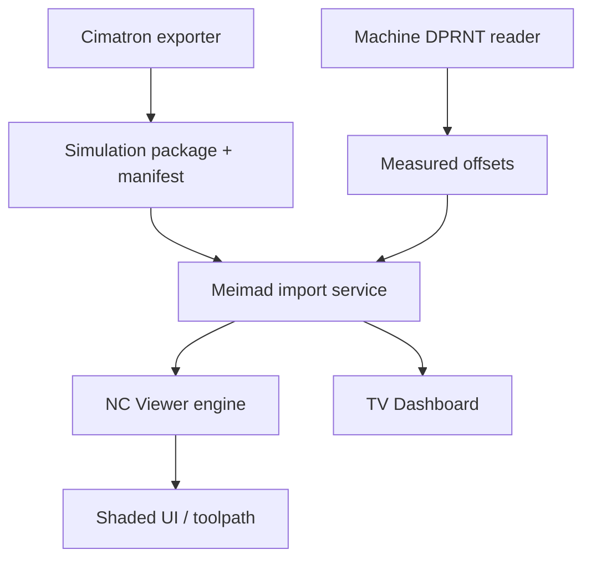

# Meimad Production Planner — единый план выполнения

Дата: 12 октября 2026

## 1. Цель

Подготовить Meimad Production Planner к автоматической загрузке производственных данных из Cimatron, корректной симуляции снятия материала и понятному отображению результата оператору.

В первую поставку входят:

1. собственное параметрическое 3D-ядро stock removal;
2. CPU reference engine и GPU/WebGPU backend;
3. 3+2 и simultaneous 5-axis движение;
4. collision control для инструмента, держателя, шпинделя и fixture;
5. импорт NC, tool list, stock, fixture, part и UCS из Cimatron через единый package;
6. импорт фактического G54–G59 с контроллера через DPRNT;
7. shaded-view станка и управляемое отображение toolpath;
8. TV Dashboard с thumbnail детали в строке станка.

## 2. Зафиксированные границы проекта

Мы не строим полноценный Vericut и не моделируем пластины как отдельные 3D-тела. Инструменты остаются параметрическими: flat, ball, bull-nose, taper, drill, holder, spindle и fixture primitives. Это сохраняет управляемый объём работ и соответствует текущему Meimad.

Все результаты должны работать без коммерческого CAM-ядра. GPU ускоряет вычисления, но CPU reference engine остаётся эталоном для тестов и запасным режимом.

## 3. Архитектура поставки



Границы модулей:

| Модуль | Ответственность |
|---|---|
| `CimatronExporter` | Собрать NC, инструменты, holder, stock, fixture, part, UCS и manifest |
| `PackageImporter` | Проверить package, хэши, версии схемы и координаты |
| `CoordinateService` | Сопоставить Cimatron UCS, NC zero и машинный G54–G59 |
| `DprntReader` | Принять, распарсить и сохранить измеренные offsets |
| `SimulationCore` | Движение инструмента, stock removal, collisions, verification |
| `GpuBackend` | Параллельное выполнение voxel removal на WebGPU |
| `VisualizationLayer` | Scene graph, shaded view, toolpath visibility, playback |
| `TvDashboardProjection` | Компактная строка станка и versioned thumbnail |

## 4. Порядок реализации

### Этап 0 — контракты и тестовый набор

**Задача:** заморозить форматы до написания движка.

Сделать:

- версионированные схемы `simulation-package.json`, `tool-table.json`, `coordinate-systems.json`;
- enum ролей файлов: `nc`, `initialStock`, `remainingStock`, `fixture`, `part`, `machineScene`;
- единицы измерения и правило: внутренние координаты в миллиметрах;
- правило трансформаций: `file coordinates → Cimatron UCS → NC zero → machine coordinates`;
- 3 маленьких эталонных NC-файла: 3-axis, 3+2, simultaneous 5-axis;
- эталонные stock/fixture/part и ожидаемые bounding boxes;
- CI-проверку JSON schema и golden-файлов.

**Готово, когда:** package можно проверить без UI, а для каждого объекта однозначно определены роль, единицы, UCS, источник и hash.

### Этап 1 — CPU reference engine

**Задача:** получить медленный, но проверяемый результат.

Сделать:

- sparse voxel blocks с configurable cell size;
- импорт box, cylinder и STL stock;
- параметрические cutter sweeps для flat, ball, bull-nose, taper и drill;
- дискретизацию линейного и rotary движения;
- сохранение snapshots после каждого блока движения;
- mesh extraction и STL export;
- журнал команд: line number, tool, pose, removed volume, warnings.

**Готово, когда:** результат на простых 3-axis и 3+2 тестах совпадает с golden output в заданном допуске.

### Этап 2 — GPU/WebGPU backend

**Задача:** ускорить уже проверенный алгоритм, не меняя его контракт.

Сделать:

- storage buffers для voxel blocks и tool poses;
- compute pass для swept-volume removal;
- frustum/brick culling;
- adaptive subdivision по длине перемещения и углу ориентации;
- GPU mesh update только для изменённых блоков;
- fallback на CPU при отсутствии WebGPU или при диагностической ошибке.

**Готово, когда:** GPU и CPU дают одинаковый результат в допуске, а эталонная программа проигрывается заметно быстрее CPU baseline.

### Этап 3 — simultaneous 5-axis и кинематика

**Задача:** правильно обработать положение и ориентацию инструмента.

Сделать:

- интерполяцию position и orientation между NC-кадрами;
- adaptive step по translational distance и angular distance;
- machine kinematic chain из manifest;
- лимиты осей, rotary wrapping и singularity warnings;
- сохранение фактической pose каждого sample для повторяемости.

**Готово, когда:** контрольные 3+2 и simultaneous 5-axis траектории не пропускают материал и не создают ложное снятие выше допуска.

### Этап 4 — collision control

**Задача:** обнаруживать опасные контакты без дорогой геометрической системы.

Уровень 1: быстрые bounding volumes и swept capsules/cones для каждой pose.

Уровень 2: точная проверка параметрических holder/spindle/fixture primitives и mesh fixture/part.

Событие collision содержит: тип, время/line number, machine pose, объекты, penetration depth, severity. Политики: `warning`, `error`, `stop playback`.

**Готово, когда:** тесты ловят holder–fixture, spindle–fixture, cutter–fixture и cutter–finished-part, а безопасные траектории не дают ложных остановок.

### Этап 5 — Cimatron exporter и package importer

**Задача:** убрать ручное создание моделей и позиционирование.

Exporter должен:

1. определить активный job, machine, operation и UCS;
2. экспортировать NC по нужному UCS;
3. выгрузить cutter/holder table;
4. выгрузить initial или remaining stock;
5. выгрузить fixture и part;
6. прочитать UCS transformation;
7. собрать manifest, checksums и exporter version;
8. атомарно записать `.meimad-sim` package;
9. вернуть человеку отчёт об ошибках и предупреждениях.

Запуск: предпочтительно Cimatron add-in, затем postprocessor hook. BAT и folder watcher оставить fallback.

Importer обязан отклонять package при отсутствии NC, manifest, UCS или обязательного stock; предупреждать о несовпадении единиц, machine mapping и версии схемы.

**Готово, когда:** один запуск из Cimatron создаёт пакет, который открывается в Meimad без ручного выбора STL и без ручного вращения моделей.

### Этап 6 — фактические G54–G59 через DPRNT

**Задача:** сохранить измеренное положение детали на конкретной машине.

NC вставляет маркированный блок `MEIMAD/OFFSET_START`, поля `machine`, `operation`, `program`, `workOffset`, `x/y/z/a/b`, timestamp и `MEIMAD/OFFSET_END`. Reader принимает TCP, serial-to-LAN или файл-папку в зависимости от контроллера.

Parser должен быть потоковым, идемпотентным и append-only. Неполный или повторный блок не применяется к симуляции. После валидации offset сохраняется с machine id, operation id, source, received time и raw payload.

**Готово, когда:** Meimad может показать текущий G54, применить его к NC Viewer и восстановить его после перезапуска для выбранной машины и операции.

### Этап 7 — визуальный слой NC Viewer

Сделать:

- shaded machine, fixture, stock и finished part;
- scene graph, привязанный к кинематическим узлам;
- режимы toolpath: hidden, passed, remaining, all, current tool, selected tool, selected operation;
- текущий tool и progress marker;
- collision markers и camera presets;
- нормальные icon buttons с tooltip, keyboard shortcut и disabled state;
- synchronized playback: NC time, stock, tool, toolpath и camera state.

**Готово, когда:** оператор может понять текущую операцию за несколько секунд, скрыть лишний toolpath и увидеть станок в качественном shaded view.

### Этап 8 — TV Dashboard

Каждая строка станка получает компактный блок: thumbnail детали, Part Number, Case/part name, текущая операция, имя станка, status, progress и warning.

Thumbnail priority:

1. preview из case;
2. thumbnail finished-part STL из package;
3. закэшированный screenshot;
4. placeholder с Part Number.

В projection передавать `thumbnailUrl`, `thumbnailVersion`, `thumbnailAlt`, `partNumber` и `operationName`. Кэш ключуется по `partId + thumbnailVersion`; статусные обновления не должны заново загружать изображение. При offline показывать последнюю валидную картинку и время snapshot.

**Готово, когда:** картинка остаётся читаемой на телевизоре, не ломает компактную строку, не вызывает лишних запросов и заменяется атомарно при смене версии.

## 5. API-контракты

Минимальные интерфейсы:

```text
IStockSimulator.Load(package, coordinateContext)
IStockSimulator.ApplyMotion(MotionSample[] samples)
IStockSimulator.GetSnapshot(snapshotId)
IStockSimulator.GetCollisions(filter)
IStockSimulator.ExportMesh(format)

IPackageImporter.Validate(packagePath)
IPackageImporter.Import(packagePath)
ICoordinateService.Resolve(program, operation, machine)
IDprntReader.Read(stream)
IDprntStore.Save(measuredOffset)
ITvDashboardProjection.Project(machineId)
```

Все длительные операции поддерживают cancellation, progress и structured diagnostics. Ошибки не должны оставаться только в UI-тексте: каждая имеет стабильный code и context.

## 6. Первый исполнимый спринт

Порядок задач:

1. Создать schema и один минимальный `.meimad-sim` package.
2. Написать `PackageImporter.Validate` и golden test.
3. Подключить существующую параметрическую модель инструмента.
4. Реализовать CPU box stock + flat cutter на одной линейной траектории.
5. Сохранить первый snapshot и экспортировать STL.
6. Добавить scene group `machine/fixture/stock/part/toolpath`.
7. Добавить в TV Dashboard thumbnail projection и version cache.
8. Провести demo: Cimatron package → Meimad import → simulation → TV row.

Не начинать simultaneous 5-axis, DPRNT transport и GPU compute до того, как этот вертикальный срез проходит end-to-end.

## 7. Definition of Done для релиза MVP

- package импортируется без ручного выбора моделей;
- координаты и единицы видны в диагностике;
- CPU engine даёт воспроизводимый результат;
- GPU backend имеет CPU fallback;
- 3+2 работает на эталонной программе;
- collisions отображаются с line number и severity;
- toolpath можно скрыть, разделить на прошлый/будущий и ограничить текущим инструментом;
- станок, fixture, stock и part отображаются в shaded view;
- TV Dashboard показывает thumbnail, Part Number, операцию, станок и status;
- DPRNT offset валидируется, сохраняется и применяется только к правильной машине/операции;
- все блокирующие ошибки видны оператору и записаны в журнал;
- есть regression suite для package, coordinates, simulation, collisions и dashboard projection.

## 8. Главные риски и решения

| Риск | Решение |
|---|---|
| Ошибка UCS/NC zero | Явный transform chain и golden coordinate tests |
| GPU расходится с CPU | CPU остаётся oracle, differential tests на каждом build |
| 5-axis пропускает материал | adaptive sampling по расстоянию и углу |
| Медленный mesh rebuild | dirty voxel blocks и background extraction |
| Неполный DPRNT | state machine, checksum/duplicate guard, quarantine raw log |
| TV перегружен изображениями | фиксированный thumbnail, versioned cache, placeholder |
| Cimatron API различается по версиям | capability detection и versioned adapter |

## 9. Артефакты, которые уже подготовлены

- [План реализации движка снятия материала](nc-viewer-material-simulation-implementation-plan.md)
- [Спецификация визуального слоя и TV Dashboard](nc-viewer-visualization-spec.md)
- [Определение Cimatron → Meimad exporter и DPRNT importer](cimatron-to-meimad-exporter-definition.md)

Этот документ является верхнеуровневым execution plan. Три связанные спецификации остаются источниками деталей для соответствующих команд и модулей.
